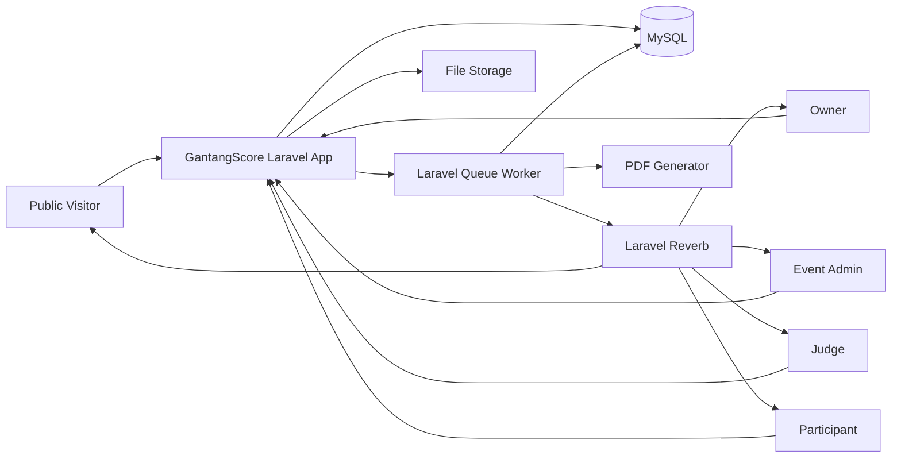
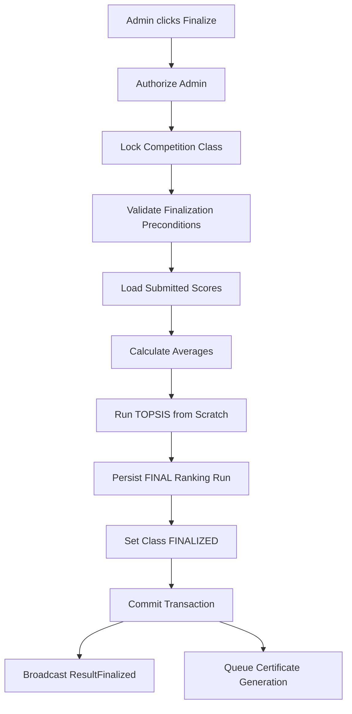
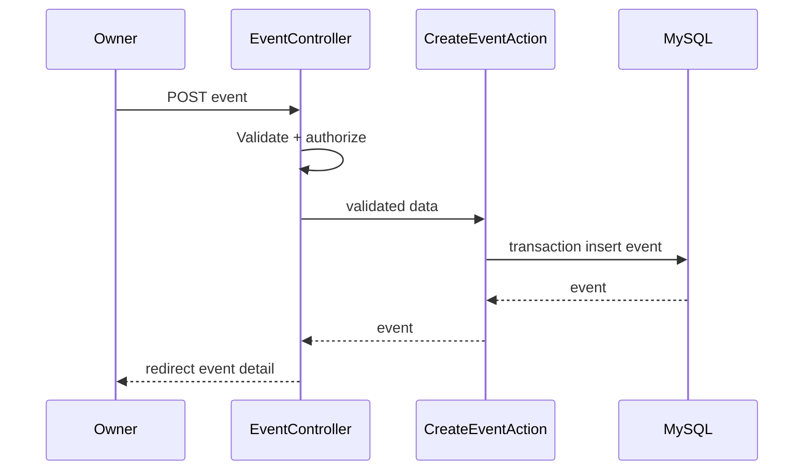
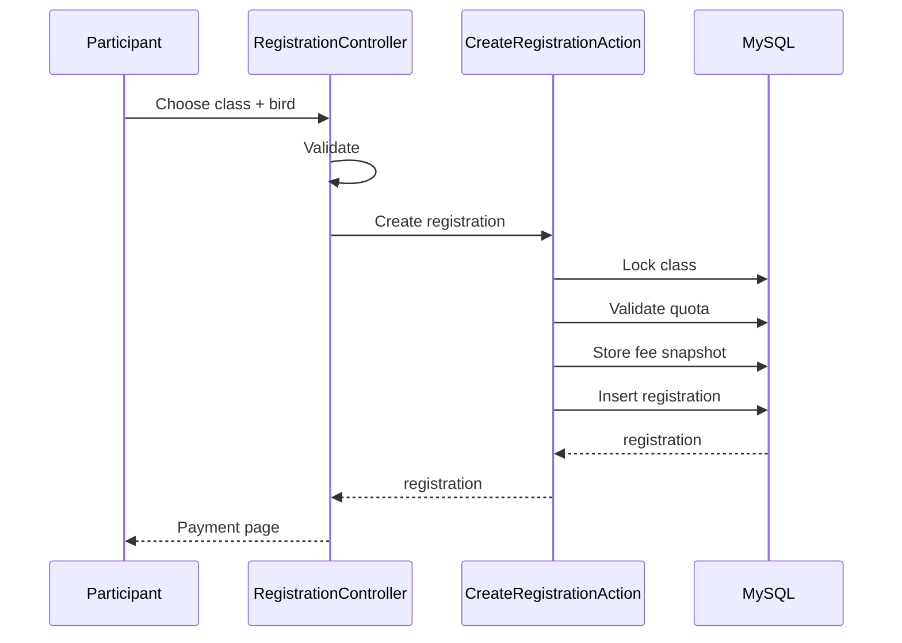
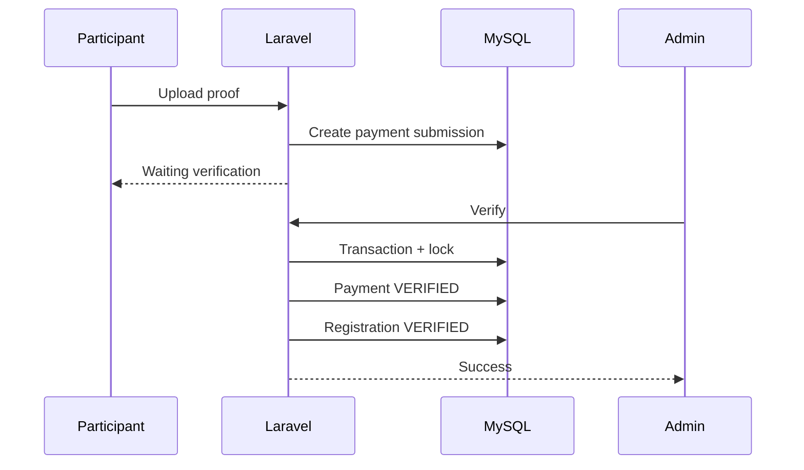
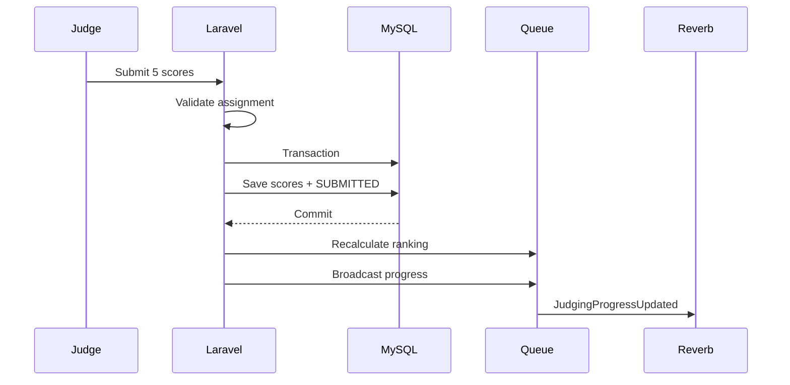
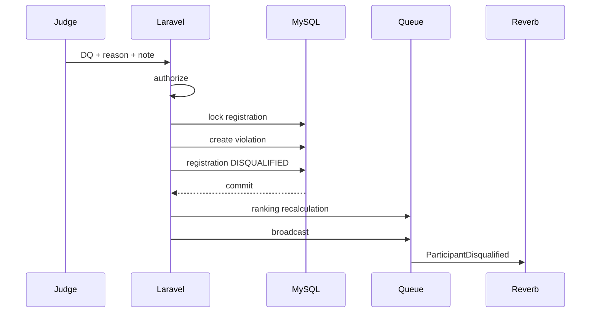
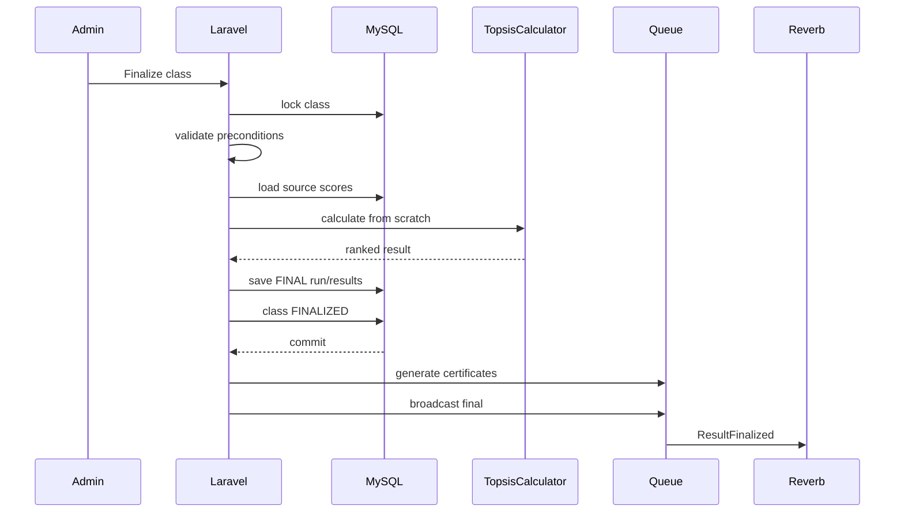

# Architecture.md — GantangScore

> **Purpose:** Dokumen arsitektur utama untuk developer dan AI coding agent (termasuk Codex).
>
> Sebelum membuat atau mengubah kode, agent WAJIB membaca:
>
> 1. `PRD.md` — business requirements dan rules.
> 2. `Design.md` — UI/UX, layout, design system, responsive behavior.
> 3. `Architecture.md` — struktur teknis, boundary, flow, conventions, dan implementation rules.
>
> Jika terdapat konflik:
>
> **Business rule:** `PRD.md` menang.  
> **UI/UX:** `Design.md` menang.  
> **Technical structure:** `Architecture.md` menang.
>
> Agent **tidak boleh mengarang requirement bisnis yang belum ditentukan**. Tandai sebagai TODO / Open Question dan jangan membuat aturan diam-diam.

---

# 1. Product Summary

**Product Name:** GantangScore  
**Formal Name:** Sistem Penjurian Kompetisi Gantangan Burung Menggunakan Metode TOPSIS  
**Architecture Style:** Modular Monolith  
**Backend:** Laravel  
**Frontend:** Laravel Blade  
**Database:** MySQL  
**Realtime:** Laravel Reverb + Laravel Echo  
**UI Interaction:** Blade + progressive JavaScript; Alpine.js diperbolehkan untuk interaksi lokal  
**Asset Bundling:** Vite  
**Queue:** Laravel Queue  
**Default Queue Backend MVP:** Database Queue  
**Cache MVP:** Laravel cache default / database/file sesuai environment  
**Redis:** Optional optimization; JANGAN menjadi dependency wajib MVP kecuali diminta eksplisit  
**PDF:** Server-side generated PDF untuk bukti pendaftaran dan piagam  
**Authentication:** Laravel web session authentication  
**Authorization:** Laravel Policies / Gates + scoped ownership/assignment checks

---

# 2. Architecture Decision

## 2.1 Chosen Architecture: Modular Monolith

GantangScore adalah satu aplikasi Laravel dan satu database utama.

```text
Browser
   │
   ▼
Laravel Application
   │
   ├── Public Website
   ├── Owner Module
   ├── Admin Module
   ├── Judge Module
   ├── Participant Module
   ├── Competition Domain
   ├── Registration Domain
   ├── Judging Domain
   ├── TOPSIS Domain
   ├── Payment Domain
   └── Certificate Domain
   │
   ▼
MySQL
```

Tidak menggunakan microservices pada MVP.

### Alasan

- Scope aplikasi masih cocok untuk satu codebase.
- Transaction lintas registration, judging, ranking, dan event lebih sederhana.
- Deployment lebih mudah.
- Debugging lebih mudah.
- Cocok untuk Laravel Blade.
- Tidak membutuhkan distributed-system complexity.
- Tetap dapat dipisah menjadi service di masa depan jika benar-benar diperlukan.

---

# 3. Non-Negotiable Architecture Rules

AI agent dan developer **WAJIB** mengikuti aturan berikut.

## AR-001 — Controllers Harus Tipis

Controller bertanggung jawab pada:

```text
Request
→ Authorization
→ Call Action/Service
→ Return Response
```

Controller TIDAK boleh berisi:

- Algoritma TOPSIS.
- Query bisnis kompleks puluhan baris.
- Perhitungan ranking.
- Logika diskualifikasi.
- State transition kompleks.
- PDF generation logic.
- Broadcast orchestration kompleks.

---

## AR-002 — Database adalah Source of Truth

WebSocket/Reverb hanya digunakan untuk mengirim perubahan terbaru ke browser.

```text
HTTP Command
   ↓
Validate
   ↓
Authorize
   ↓
Database Transaction
   ↓
Commit
   ↓
Domain Event
   ↓
Broadcast
```

JANGAN:

```text
WebSocket
→ ubah state client
→ anggap data sudah tersimpan
```

Jika Reverb mati, sistem inti harus tetap berfungsi melalui HTTP.

---

## AR-003 — TOPSIS Hanya Ada di Satu Domain Service

Semua perhitungan TOPSIS harus melalui:

```text
App\Domain\Ranking\Services\TopsisCalculator
```

Dilarang menyalin formula TOPSIS ke:

- Controller.
- Blade.
- JavaScript.
- Job lain.
- Model accessor.
- Command lain.

---

## AR-004 — Ranking Final Tidak Boleh Diubah Manual

Ranking final harus berasal dari:

```text
Submitted Judge Scores
→ Average
→ TOPSIS
→ Ranking
```

Tidak boleh ada field UI:

```text
Edit Rank
```

Tidak boleh ada:

```text
admin memasukkan rank manual
```

Jika business rule berubah nanti, buat proses koreksi formal dengan audit trail.

---

## AR-005 — Semua Authorization Harus Server-Side

Menyembunyikan tombol bukan security.

Semua action wajib diperiksa oleh:

- Policy.
- Gate.
- Scoped query.
- Ownership / assignment.

---

## AR-006 — Final Data Harus Reproducible

Hasil final wajib menyimpan snapshot data perhitungan.

Perubahan master data setelah event selesai tidak boleh mengubah hasil historis.

---

## AR-007 — Business State Tidak Boleh Ditentukan dari Tampilan

Status seperti:

```text
ONGOING
VERIFIED
DISQUALIFIED
FINAL
```

harus berasal dari database/domain state, bukan dihitung hanya dari badge/UI.

---

## AR-008 — Tidak Membuat Requirement Baru

Agent tidak boleh menambahkan:

- Payment gateway.
- WhatsApp.
- Email notification.
- AI judging.
- Live streaming.
- Mobile app.
- Manual ranking override.

kecuali ada requirement baru.

---

# 4. High-Level System Context



---

# 5. Runtime Components

Minimum runtime MVP:

```text
1. Web Server / Reverse Proxy
2. Laravel PHP Application
3. MySQL
4. Queue Worker
5. Laravel Reverb Server
6. Scheduler Worker / Cron
```

Recommended production processes:

```text
nginx
php-fpm
php artisan queue:work
php artisan reverb:start
php artisan schedule:work
```

Jika menggunakan Docker:

```text
nginx
app
queue
reverb
scheduler
mysql
```

`app`, `queue`, `reverb`, dan `scheduler` boleh berasal dari image aplikasi Laravel yang sama tetapi menjalankan command berbeda.

---

# 6. Technology Constraints

## Required

- PHP versi yang kompatibel dengan versi Laravel project.
- Laravel versi stable yang dipilih project.
- MySQL.
- Blade.
- Laravel Reverb.
- Laravel Echo.
- Vite.
- Composer.
- Node.js hanya untuk asset build.

## Allowed

- Alpine.js untuk UI interaction ringan.
- Tailwind CSS jika dipilih saat bootstrap project.
- Package PDF yang stabil dan kompatibel Laravel.
- Implementasi Tahap 4 menggunakan `barryvdh/laravel-dompdf` untuk bukti pendaftaran satu dokumen per permintaan. Rendering dilakukan setelah verifikasi tersimpan, di luar transaksi, dengan remote resource, PHP, dan JavaScript dinonaktifkan. Pekerjaan PDF berat tetap menjadi kandidat queue.
- PHPUnit / Pest sesuai setup project.

## Not Required for MVP

- React.
- Vue SPA.
- Inertia.
- Livewire.
- Redis.
- Elasticsearch.
- Kafka.
- RabbitMQ.
- Kubernetes.

Jangan menambah teknologi tersebut tanpa alasan yang jelas dan requirement eksplisit.

---

# 7. Architectural Layers

```text
┌──────────────────────────────────────┐
│ Presentation Layer                   │
│ Blade, Controllers, Form Requests    │
├──────────────────────────────────────┤
│ Application Layer                    │
│ Actions, Use Cases, Jobs, Listeners  │
├──────────────────────────────────────┤
│ Domain Layer                         │
│ Services, Rules, Enums, DTOs         │
├──────────────────────────────────────┤
│ Persistence / Infrastructure         │
│ Eloquent, MySQL, Storage, Reverb     │
└──────────────────────────────────────┘
```

---

# 8. Recommended Directory Structure

```text
app/
├── Domain/
│   ├── Event/
│   │   ├── Actions/
│   │   ├── DTOs/
│   │   ├── Enums/
│   │   ├── Events/
│   │   ├── Services/
│   │   └── Rules/
│   │
│   ├── Registration/
│   │   ├── Actions/
│   │   ├── DTOs/
│   │   ├── Enums/
│   │   ├── Events/
│   │   └── Services/
│   │
│   ├── Payment/
│   │   ├── Actions/
│   │   ├── Enums/
│   │   ├── Events/
│   │   └── Services/
│   │
│   ├── Judging/
│   │   ├── Actions/
│   │   ├── DTOs/
│   │   ├── Enums/
│   │   ├── Events/
│   │   ├── Rules/
│   │   └── Services/
│   │
│   ├── Ranking/
│   │   ├── Actions/
│   │   ├── DTOs/
│   │   ├── Events/
│   │   ├── Jobs/
│   │   └── Services/
│   │       ├── TopsisCalculator.php
│   │       └── RankingService.php
│   │
│   └── Certificate/
│       ├── Actions/
│       ├── Jobs/
│       └── Services/
│
├── Events/
├── Http/
│   ├── Controllers/
│   │   ├── Public/
│   │   ├── Owner/
│   │   ├── Admin/
│   │   ├── Judge/
│   │   └── Participant/
│   ├── Middleware/
│   └── Requests/
│       ├── Owner/
│       ├── Admin/
│       ├── Judge/
│       └── Participant/
│
├── Jobs/
├── Listeners/
├── Models/
├── Policies/
├── Providers/
└── Support/
    ├── Money/
    ├── Files/
    └── Helpers/
```

Tidak perlu membuat interface/repository untuk semua model.

Gunakan Eloquent secara langsung kecuali benar-benar ada kebutuhan abstraction.

---

# 9. Frontend Directory Structure

```text
resources/
├── css/
│   └── app.css
│
├── js/
│   ├── app.js
│   ├── echo.js
│   ├── realtime/
│   │   ├── admin-judging.js
│   │   ├── public-live.js
│   │   └── result.js
│   └── components/
│
└── views/
    ├── layouts/
    │   ├── public.blade.php
    │   ├── dashboard.blade.php
    │   ├── guest.blade.php
    │   └── app.blade.php
    │
    ├── components/
    │   ├── ui/
    │   ├── event/
    │   ├── judging/
    │   ├── ranking/
    │   └── participant/
    │
    ├── public/
    ├── owner/
    ├── admin/
    ├── judge/
    └── participant/
```

Ikuti komponen UI dan naming dari `Design.md`.

---

# 10. Route Architecture

Route harus dipisahkan berdasarkan audience agar tidak menjadi satu file raksasa.

Recommended:

```text
routes/
├── web.php
├── channels.php
├── owner.php
├── admin.php
├── judge.php
└── participant.php
```

`web.php`:

```text
Public pages
Auth pages
Include role route files
```

Route prefixes:

```text
/owner/*
/admin/*
/judge/*
/participant/*
```

Route names:

```text
owner.*
admin.*
judge.*
participant.*
```

Example:

```text
owner.events.index
admin.events.classes.index
judge.classes.judging.show
participant.registrations.show
```

---

# 11. Identity and Role Model

Satu tabel utama:

```text
users
```

User dapat mempunyai lebih dari satu role.

Global roles:

```text
OWNER
ADMIN
JUDGE
PARTICIPANT
```

Relasi:

```text
users
  └── user_roles
        └── role
```

Important:

Global role **tidak otomatis memberikan akses ke semua data**.

Contoh:

```text
ADMIN
```

hanya berarti user mempunyai capability menjadi admin.

Akses event tertentu tetap harus melalui:

```text
event_admins
```

Judge tertentu hanya boleh menilai kelas melalui:

```text
judge_assignments
```

---

# 12. Authorization Model

## Owner

Akses jika:

```text
event.owner_id === auth()->id()
```

---

## Admin

Akses event jika terdapat:

```text
event_admins.event_id = event.id
AND
event_admins.user_id = auth()->id()
```

---

## Judge

Akses penilaian kelas jika terdapat:

```text
judge_assignments.competition_class_id = class.id
AND
judge_assignments.judge_id = auth()->id()
```

---

## Participant

Akses private registration jika:

```text
registration.participant_id = auth()->id()
```

Akses bird jika:

```text
bird.owner_id = auth()->id()
```

---

# 13. Policy Requirements

Minimum policies:

```text
EventPolicy
CompetitionClassPolicy
RegistrationPolicy
PaymentSubmissionPolicy
JudgeEvaluationPolicy
ViolationPolicy
TopsisResultPolicy
CertificatePolicy
BirdPolicy
```

Policy bukan hanya `view/update/delete`.

Gunakan action domain-specific jika perlu:

```text
assignAdmin
verifyPayment
score
warn
disqualify
finalizeResult
downloadCertificate
```

---

# 14. Core Database Model

Core entities:

```text
users
user_roles

events
event_admins

competition_classes
competition_class_criteria
prizes

birds
registrations

payment_submissions

judge_assignments
judge_evaluations
judge_scores

violations

ranking_runs
ranking_results

certificates

activity_logs
```

---

# 15. Database Naming Conventions

Table:

```text
snake_case
plural
```

Column:

```text
snake_case
```

Foreign key:

```text
{entity}_id
```

Timestamp:

```text
created_at
updated_at
submitted_at
verified_at
finalized_at
```

Boolean:

```text
is_active
is_public
```

Money:

Use integer smallest practical currency unit for Rupiah.

Since Rupiah has no commonly used decimal subdivision:

```text
registration_fee = BIGINT
cash_amount = BIGINT
```

Example:

```text
150000
```

Presentation:

```text
Rp150.000
```

---

# 16. Users

```text
users
-----
id
name
email
phone
password
status
email_verified_at nullable
remember_token nullable
created_at
updated_at
```

Unique:

```text
email
```

Phone may become unique if product later requires it.

Do not expose password or private contact publicly.

---

# 17. User Roles

```text
user_roles
----------
id
user_id
role
created_at
```

Unique:

```text
user_id + role
```

Role should be PHP backed enum.

Example:

```php
enum UserRole: string
{
    case OWNER = 'OWNER';
    case ADMIN = 'ADMIN';
    case JUDGE = 'JUDGE';
    case PARTICIPANT = 'PARTICIPANT';
}
```

---

# 18. Events

```text
events
------
id
owner_id
name
slug
description
banner_path nullable
location_name
address
registration_open_at
registration_close_at
start_at
end_at
contact_person nullable
contact_phone nullable
status
published_at nullable
created_at
updated_at
```

Indexes:

```text
owner_id
status
start_at
slug UNIQUE
```

---

# 19. Event Status State Machine

Allowed:

```text
DRAFT
UPCOMING
ONGOING
COMPLETED
CANCELLED
```

Typical transition:

```text
DRAFT
 ↓ publish
UPCOMING
 ↓ start
ONGOING
 ↓ complete
COMPLETED
```

Alternative:

```text
DRAFT/UPCOMING → CANCELLED
```

Agent must not allow arbitrary status jumping without a domain action.

Suggested actions:

```text
PublishEventAction
StartEventAction
CompleteEventAction
CancelEventAction
```

---

# 20. Event Admins

```text
event_admins
------------
id
event_id
user_id
created_at
```

Unique:

```text
event_id + user_id
```

Deleting assignment does not delete user account.

---

# 21. Competition Classes

```text
competition_classes
-------------------
id
event_id
name
slug
bird_type
description nullable
registration_fee
quota nullable
start_at
end_at nullable
status
created_at
updated_at
```

Unique recommended:

```text
event_id + slug
```

Indexes:

```text
event_id
status
bird_type
```

---

# 22. Class Status

```text
UPCOMING
ONGOING
JUDGING_COMPLETED
FINALIZED
CANCELLED
```

Do not infer `FINALIZED` merely because event ended.

---

# 23. Criteria Architecture

MVP UI menggunakan lima kriteria fixed:

```text
Irama Lagu              40%
Durasi Kerja            20%
Volume                  20%
Gaya                    10%
Fisik                   10%
```

All:

```text
type = BENEFIT
score range = 1..10
```

Namun data disimpan sebagai **snapshot per competition class**.

Table:

```text
competition_class_criteria
--------------------------
id
competition_class_id
code
name
weight
type
min_score
max_score
sort_order
created_at
updated_at
```

Why snapshot?

Jika bobot berubah di masa depan, event lama harus tetap menggunakan bobot historisnya.

Unique:

```text
competition_class_id + code
```

Weight storage:

```text
DECIMAL(8,6)
```

Example:

```text
0.400000
```

Validation:

```text
SUM(weight) == 1.000000
```

MVP UI tidak menyediakan editor weight kecuali requirement berubah.

---

# 24. Prize Model

```text
prizes
------
id
competition_class_id
rank
type
title
description nullable
cash_amount nullable
created_at
updated_at
```

Types:

```text
CASH
ITEM
OTHER
```

Unique:

```text
competition_class_id + rank
```

---

# 25. Birds

```text
birds
-----
id
owner_id
name
bird_type
photo_path
description nullable
created_at
updated_at
```

`owner_id` adalah participant user id.

Public page boleh menampilkan:

- bird name.
- bird type.
- photo.

Jangan menampilkan private participant data tanpa kebutuhan.

---

# 26. Registration Model

Satu registration:

```text
1 participant
+
1 bird
+
1 competition class
```

Table:

```text
registrations
-------------
id
competition_class_id
participant_id
bird_id

registration_number
gantangan_number nullable

registration_fee_snapshot

status

registered_at
verified_at nullable
disqualified_at nullable

created_at
updated_at
```

Important:

```text
registration_fee_snapshot
```

harus menyimpan harga saat peserta mendaftar.

Perubahan harga kelas kemudian tidak boleh mengubah tagihan historis.

---

# 27. Registration Status

Recommended:

```text
PENDING_PAYMENT
WAITING_VERIFICATION
VERIFIED
PAYMENT_REJECTED
CANCELLED
DISQUALIFIED
```

Transition:

```text
PENDING_PAYMENT
    ↓ upload payment
WAITING_VERIFICATION
    ├── verify → VERIFIED
    └── reject → PAYMENT_REJECTED
                    ↓ re-upload
              WAITING_VERIFICATION
```

Competition:

```text
VERIFIED
   ↓ serious violation
DISQUALIFIED
```

Jangan menghapus registration karena diskualifikasi.

---

# 28. Registration Constraints

At minimum:

Participant cannot register:

- class not open.
- event registration closed.
- incompatible bird type.
- class quota exceeded.
- bird not owned by participant.
- duplicate registration if duplicate is prohibited.

Open Question:

Apakah burung yang sama dapat mengikuti beberapa kelas dalam event yang sama belum final.

Agent jangan membuat unique constraint lintas event/class yang mengunci keputusan ini tanpa requirement.

---

# 29. Payment Architecture

MVP menggunakan manual payment proof.

Important refinement:

**Jangan overwrite bukti pembayaran lama.**

Gunakan:

```text
payment_submissions
```

Satu registration dapat memiliki banyak attempts.

```text
registrations
   │
   ├── payment submission #1 REJECTED
   ├── payment submission #2 REJECTED
   └── payment submission #3 VERIFIED
```

---

# 30. Payment Submission

```text
payment_submissions
-------------------
id
registration_id
amount
proof_path
status
uploaded_at
reviewed_by nullable
reviewed_at nullable
rejection_reason nullable
created_at
updated_at
```

Statuses:

```text
WAITING_VERIFICATION
VERIFIED
REJECTED
```

Constraint:

Satu registration hanya boleh mempunyai maksimal satu submission aktif:

```text
WAITING_VERIFICATION
```

pada satu waktu.

Application layer wajib enforce.

---

# 31. Payment Verification Transaction

```text
Admin POST verify
    ↓
Authorize event admin
    ↓
DB transaction
    ↓
Lock payment submission
    ↓
Ensure status = WAITING_VERIFICATION
    ↓
Set payment = VERIFIED
    ↓
Set reviewed_by/admin
    ↓
Set registration = VERIFIED
    ↓
Commit
    ↓
Dispatch PaymentVerified
```

Use row locking for concurrency-sensitive verify/reject action.

---

# 32. Judge Assignment

```text
judge_assignments
-----------------
id
competition_class_id
judge_id
created_at
```

Unique:

```text
competition_class_id + judge_id
```

Judge global role does not imply class access.

---

# 33. Judge Evaluation

One evaluation represents:

```text
one judge
judging
one registration
```

Table:

```text
judge_evaluations
-----------------
id
registration_id
judge_id
status
submitted_at nullable
created_at
updated_at
```

Unique:

```text
registration_id + judge_id
```

Status:

```text
DRAFT
SUBMITTED
```

---

# 34. Judge Scores

```text
judge_scores
------------
id
judge_evaluation_id
criterion_id
score
created_at
updated_at
```

Score:

```text
TINYINT UNSIGNED
1..10
```

Unique:

```text
judge_evaluation_id + criterion_id
```

Database may not fully enforce check in every environment; application validation is mandatory.

---

# 35. Score Submission Rules

Implementasi Tahap 5 menggunakan `SaveEvaluationAction` dengan dua endpoint terpisah untuk draft dan submit. Urutan penguncian penulisan nilai adalah kelas, pendaftaran, lalu evaluasi; validasi snapshot dan status diperiksa di dalam transaksi sebelum skor ditulis. `JudgeScoreSubmitted` memakai `ShouldDispatchAfterCommit`. Konsumen ranking/realtime akan ditambahkan pada tahap masing-masing.

Admin menggunakan `StartClassJudgingAction` untuk membuka kelas secara eksplisit; event dipindahkan ke `ONGOING` bila masih `UPCOMING`. Progress 100% tidak mengubah status kelas secara otomatis. Aksi mulai mengunci event lalu kelas untuk menyelaraskan status event saat beberapa kelas dibuka bersamaan.

To submit:

1. Judge is assigned to class.
2. Registration is VERIFIED.
3. Registration is not DISQUALIFIED.
4. Evaluation status is DRAFT.
5. Every class criterion has exactly one score.
6. Every score is within criterion range.

Transaction:

```text
Validate
↓
lock evaluation
↓
re-check status
↓
set SUBMITTED
↓
submitted_at = now()
↓
commit
↓
JudgeScoreSubmitted event
↓
Recalculate provisional ranking
```

---

# 36. Submitted Score Immutability

Default MVP rule:

After `SUBMITTED`, judge evaluation is read-only.

Because PRD still has open question about score correction:

**DO NOT implement edit-after-submit unless explicitly decided.**

If future requirement allows correction:

- Keep revision history.
- Require explicit permission.
- Recalculate provisional ranking.
- Audit old and new values.

---

# 37. Judge Isolation

A judge must not see other judges' scores before their own final submission.

Even after submit, exposing other judges' values is not required in MVP.

Enforce this in backend query, not only Blade.

---

# 38. Violations

```text
violations
----------
id
registration_id
judge_id
action
reason_code
reason
note
created_at
```

Actions:

```text
WARNING
DISQUALIFICATION
```

Recommended reason codes:

```text
SHOUTING
PROVOCATION
DISTURBING
LATE_HANGING
NUMBER_MANIPULATION
OTHER
```

Reason label may be localized in UI.

---

# 39. Warning Logic

Current business rule:

```text
First warning-type violation
→ WARNING

Repeated warning-type violation
→ DISQUALIFIED
```

Direct DQ examples:

```text
LATE_HANGING
NUMBER_MANIPULATION
```

Do not hardcode text matching.

Use domain rule:

```text
ViolationRuleService
```

that maps reason code to:

```text
WARNING_ELIGIBLE
DIRECT_DQ
```

---

# 40. Disqualification Transaction

Implementasi Tahap 6 memakai `RecordViolationAction` dan `ViolationRuleService`. Urutan lock sama dengan penulisan nilai: kelas lalu pendaftaran. Penugasan, status event/kelas/pendaftaran, dan jumlah peringatan diperiksa ulang di dalam transaksi. Peringatan dihitung per pendaftaran, bukan per alasan atau per Juri. `OTHER` mengikuti intensi endpoint khusus (peringatan atau DQ berat) dan selalu memerlukan penjelasan; alasan tetap dipilih melalui kode, bukan pencocokan teks.

Semua DQ memerlukan catatan dan konfirmasi eksplisit. Form peringatan lama yang kini seharusnya mengeskalasi tidak langsung mengubah status: server menolak jika catatan/konfirmasi DQ belum ada. Audit, pelanggaran, status, dan waktu DQ disimpan atomik. Event `WarningCreated` / `ParticipantDisqualified` hanya membawa ID dan memakai `ShouldDispatchAfterCommit`. Nilai draft maupun submitted tidak diubah. Progres database segera mengecualikan DQ melalui filter `VERIFIED`.

Konsumen recalculation ranking belum diimplementasikan pada Tahap 6 karena domain ranking adalah Tahap 7. Tahap 7 wajib mengecualikan DQ dari input dan menghubungkan event DQ ke pembaruan provisional; broadcast menyusul Tahap 8. Tidak ada job kosong yang seolah-olah telah menghitung ranking.

```text
Judge requests DQ
    ↓
Authorize judge
    ↓
Validate reason + note
    ↓
DB transaction
    ↓
Lock registration
    ↓
Create violation
    ↓
Set registration DISQUALIFIED
    ↓
Set disqualified_at
    ↓
Commit
    ↓
ParticipantDisqualified event
    ↓
Recalculate provisional ranking
```

Existing scores remain in database for audit.

They are excluded from active ranking input.

---

# 41. Warning Escalation Transaction

```text
Judge warning request
    ↓
Count valid previous warnings
    ↓
If none:
    create WARNING
Else:
    create DISQUALIFICATION
    mark registration DISQUALIFIED
```

Concurrency:

Lock registration before checking warning count to avoid two judges creating simultaneous first warnings incorrectly.

---

# 42. Ranking Domain

Ranking is scoped by:

```text
competition_class_id
```

Never rank across different classes.

Input only contains registrations that:

```text
status = VERIFIED
AND not DISQUALIFIED
```

and have sufficient submitted judge evaluations according to finalized business rules.

---

# 43. Average Judge Score

For each participant `i` and criterion `j`:

```text
average(i,j)
=
sum(submitted judge scores)
/
count(submitted judge scores)
```

Only `SUBMITTED` evaluations count.

Draft score does not count.

---

# 44. TOPSIS Formula

Decision matrix:

```text
X = [xij]
```

`xij` is average judge score.

Normalize:

```text
rij = xij / sqrt(sum_i(xij^2))
```

Weighted normalized:

```text
yij = wj * rij
```

All MVP criteria are benefit.

Positive ideal:

```text
Aj+ = max_i(yij)
```

Negative ideal:

```text
Aj- = min_i(yij)
```

Positive distance:

```text
Di+ = sqrt(sum_j((yij - Aj+)^2))
```

Negative distance:

```text
Di- = sqrt(sum_j((yij - Aj-)^2))
```

Preference:

```text
Vi = Di- / (Di+ + Di-)
```

Higher:

```text
Vi
```

means better rank.

---

# 45. TopsisCalculator Contract

Class:

```text
App\Domain\Ranking\Services\TopsisCalculator
```

Must be a mostly pure service.

Suggested contract:

```php
calculate(
    array $alternatives,
    array $criteria
): TopsisCalculationResult
```

Input example:

```text
criteria:
[
  C1 { weight: .40, type: BENEFIT },
  C2 { weight: .20, type: BENEFIT },
  ...
]

alternatives:
[
  registration 10:
    C1 = 9.0000
    C2 = 8.3333
    ...
]
```

Output:

```text
matrix
normalized_matrix
weighted_matrix
positive_ideal
negative_ideal

alternatives:
  registration_id
  positive_distance
  negative_distance
  preference_value
  rank/tie-group
```

The calculator must not query database directly.

Database retrieval belongs to RankingService / Action.

---

# 46. Numeric Precision

Judge scores:

```text
integer 1..10
```

Averages:

```text
calculate with PHP numeric precision
store DECIMAL with minimum 4 decimal places
```

Preference:

```text
store at least DECIMAL(16,10)
```

UI display:

```text
4 decimal places
```

Do not round intermediate calculations unnecessarily.

Round only for storage/display according to a consistent rule.

---

# 47. TOPSIS Zero-Division Edge Cases

## Single eligible participant

No meaningful comparison exists.

Business handling:

```text
rank = 1
```

Do not attempt standard TOPSIS if it creates zero denominator.

---

## Identical alternatives

If:

```text
Di+ + Di- = 0
```

for every alternative, use:

```text
preference_value = 0.5
tie = true
```

until a business tie-break rule is defined.

Do not invent a winner.

---

# 48. Ranking Run Model

To keep historical calculations auditable:

```text
ranking_runs
------------
id
competition_class_id
type
status
criteria_snapshot JSON
input_snapshot JSON
calculated_at
finalized_at nullable
created_by nullable
created_at
```

Types:

```text
PROVISIONAL
FINAL
```

Status:

```text
COMPLETED
FAILED
```

For very large input snapshots, normalization may later use separate tables, but JSON is acceptable for MVP-scale competition if tested.

---

# 49. Ranking Results

```text
ranking_results
---------------
id
ranking_run_id
registration_id

criterion_averages JSON

positive_distance
negative_distance
preference_value

rank nullable
is_tied
created_at
```

Unique:

```text
ranking_run_id + registration_id
```

Final public ranking points to latest successful FINAL ranking run.

---

# 50. Why Ranking Snapshot Exists

Without snapshot:

```text
score edited
criterion changed
judge removed
```

could make old result impossible to reproduce.

Final ranking run stores:

- Eligible registrations.
- Criteria.
- Weights.
- Average values.
- Distances.
- Preference.
- Rank.
- Time.

---

# 51. Provisional Ranking Flow

When submitted score changes ranking input:

```text
JudgeScoreSubmitted
      ↓
Queue RecalculateProvisionalRanking
      ↓
Load class
      ↓
Load eligible scores
      ↓
Average
      ↓
TOPSIS
      ↓
Save new PROVISIONAL ranking run
      ↓
Broadcast RankingUpdated
```

Do not broadcast raw internal calculation matrices unless UI needs them.

---

# 52. Avoid Ranking Job Storm

Many judges may submit at once.

At minimum:

- Job should be unique per competition class for a short period, OR
- Dispatcher should debounce/coalesce recalculation.

If framework/package complexity is undesirable, a simple application-level lock/cache lock may be used.

Correctness > instant recalculation.

Final ranking is always recalculated from database source of truth.

---

# 53. Finalization Flow

Finalization is critical.



Never promote an old provisional ranking blindly.

Finalization must recalculate from source data.

---

# 54. Finalization Preconditions

Keputusan Owner Tahap 7, 21 Oktober 2026, menggantikan pertanyaan terbuka di bagian ini: minimal **3 Juri aktif**, seluruh evaluasi lengkap dari semua penugasan aktif pada setiap peserta eligible, dan semua draw terselesaikan. `RankingInputBuilder` memusatkan validasi tersebut. Juri absen diganti melalui `ReplaceAbsentJudgeAction`, bukan mengurangi denominator. Penugasan lama tetap disimpan dan hanya Juri tanpa nilai submitted yang dapat diganti tanpa memerlukan keputusan koreksi nilai tambahan.

Implementasi `FinalizeClassResultAction` mengunci kelas, mengotorisasi Admin event, membaca raw submitted scores terbaru, menghitung rata-rata dan TOPSIS dari awal, memverifikasi keputusan draw terhadap hash sumber, menulis FINAL dan hasilnya, mengunci kelas sebagai FINALIZED, serta mencatat audit dalam satu transaksi. `ResultFinalized` dikirim setelah commit. Tidak ada promosi provisional lama atau unfinalize. Job sertifikat dan broadcast adalah integrasi Tahap 8.

`TopsisCalculator` murni tanpa database; `RankingInputBuilder` menyiapkan input; `RankingService` menyimpan snapshot dan menerapkan urutan draw yang telah divalidasi. Seluruh rumus tetap hanya di calculator. Draw hanya memengaruhi urutan kelompok seri, bukan koefisien, matriks, atau peserta lain. Semua snapshot/model hasil append-only. Pengubahan kelas/hadiah mengunci kelas dan ditolak setelah FINALIZED.

At minimum:

- Competition class exists.
- Admin has access.
- Class not already FINALIZED.
- At least one eligible verified registration.
- No invalid registration state.
- Criteria weights valid.
- Judge score completeness passes currently defined business rule.

Approved minimum: 3 active judges, with every currently required submitted evaluation complete. A missing judge is replaced explicitly, never silently omitted. The rule is centralized in `RankingInputBuilder`; partial-submission replacement still requires an explicit future decision.

---

# 55. Final Result Immutability

Once:

```text
competition_class.status = FINALIZED
```

block:

- score edits.
- new judging.
- new DQ.
- criteria edits.
- ranking edits.
- participant modifications affecting ranking.

Admin cannot silently unfinalize.

Open Question:

Formal unfinalization/reopen flow is not defined.

Do not implement until requested.

---

# 56. Certificate Architecture

Certificates generated only from FINAL result.

Flow:

```text
ResultFinalized
   ↓
GenerateWinnerCertificates Job
   ↓
For each configured prize rank
   ↓
Generate PDF
   ↓
Store
   ↓
certificate row
```

Certificate source data should reference FINAL ranking result.

---

# 57. Registration Proof Architecture

Available only if:

```text
registration.status = VERIFIED
```

Can be generated:

- on demand, or
- cached after first generation.

Suggested:

```text
generate on demand
store stable PDF path if needed
```

Data always comes from registration snapshot/current stable verified fields.

---

# 58. File Storage

Use Laravel Storage abstraction.

Logical disks:

```text
public
private
```

Public-safe:

```text
event banners
bird photos
```

Private:

```text
payment proofs
generated internal files
```

Certificate visibility:

Participant-owned certificate should require authorization even if generated file is physically accessible through a signed/download controller route.

Do not publish payment proofs in `/storage` with predictable public URLs.

---

# 59. File Path Convention

Example:

```text
events/{event_id}/banners/{uuid}.webp

birds/{owner_id}/{bird_id}/{uuid}.webp

payments/{registration_id}/{uuid}.jpg

certificates/{event_id}/{class_id}/{uuid}.pdf

registration-proofs/{registration_id}.pdf
```

Never trust original filename as storage path.

Store sanitized metadata if original filename is needed.

---

# 60. Upload Validation

Bird photo:

```text
image
jpg/jpeg/png/webp
max 5 MB
```

Payment proof:

```text
image
jpg/jpeg/png/webp
max 5 MB
```

If PDF payment proof later needed, change requirement explicitly.

Security:

- Validate MIME.
- Generate new filename.
- Do not execute uploaded files.
- Private proof route uses authorization.

---

# 61. Activity Log

Important actions:

```text
EVENT_CREATED
EVENT_UPDATED
EVENT_PUBLISHED
EVENT_CANCELLED

ADMIN_ASSIGNED
ADMIN_REMOVED

CLASS_CREATED
CLASS_UPDATED

REGISTRATION_CREATED

PAYMENT_SUBMITTED
PAYMENT_VERIFIED
PAYMENT_REJECTED

SCORE_DRAFT_SAVED
SCORE_SUBMITTED

WARNING_CREATED
PARTICIPANT_DISQUALIFIED

PROVISIONAL_RANKING_CALCULATED
RESULT_FINALIZED

CERTIFICATE_GENERATED
```

---

# 62. Activity Log Model

```text
activity_logs
-------------
id
user_id nullable
action
subject_type
subject_id
metadata JSON nullable
ip_address nullable
created_at
```

Do not log:

- Password.
- Session token.
- Full payment proof binary.
- Sensitive secret.

---

# 63. Domain Events

Recommended events:

```text
EventCreated
EventPublished

RegistrationCreated

PaymentSubmitted
PaymentVerified
PaymentRejected

JudgeScoreSubmitted

ParticipantWarned
ParticipantDisqualified

ProvisionalRankingUpdated
ResultFinalized

CertificateGenerated
```

Domain event describes **something that already happened**.

Naming must be past tense.

---

# 64. Broadcast Events

Not every domain event must be broadcast.

Broadcast only UI-relevant events:

```text
JudgingProgressUpdated
ParticipantDisqualified
RankingUpdated
ClassResultFinalized
PaymentStatusUpdated (private participant channel if needed)
```

---

# 65. Event Dispatch Timing

Events related to committed database state should be dispatched **after database commit**.

Never broadcast:

```text
"VERIFIED"
```

before transaction actually commits.

This prevents browser receiving state that database later rolls back.

---

# 66. Reverb Channel Design

## Public Channels

For public live page:

```text
event.{eventId}.public
class.{classId}.public
```

Only broadcast public-safe payload.

Example:

```text
class id
progress count
eligible participant status
public ranking summary
```

Never broadcast:

- payment proof.
- participant email.
- participant phone.
- address.
- internal judge note.

---

## Private Admin Channel

```text
private-event.{eventId}.admin
```

Authorization:

Current user must be owner of event or event admin.

---

## Private Judge Channel

```text
private-class.{classId}.judge.{judgeId}
```

Authorization:

Judge must be assigned to class and id must match authenticated user.

---

## Private Participant Channel

```text
private-user.{userId}
```

Authorization:

```text
auth()->id() === userId
```

---

# 67. Reverb Payload Rules

Keep payload small.

Good:

```json
{
  "class_id": 10,
  "completed_evaluations": 45,
  "total_evaluations": 60,
  "progress": 75
}
```

Bad:

```text
broadcast entire event
all participants
all payments
all judge scores
full ranking matrix
```

Client can fetch detail through authorized HTTP endpoint when needed.

---

# 68. Realtime Failure Strategy

Reverb failure must not block:

- Payment verification.
- Score submission.
- DQ.
- Finalization.

Frontend:

```text
Connected
Reconnecting
Offline fallback
```

Optional fallback:

Poll a lightweight endpoint every 15–30 seconds while realtime is disconnected.

Do not poll while WebSocket works.

---

# 69. Queue Architecture

Required queue tasks:

```text
Broadcast events
Provisional ranking recalculation
Certificate generation
Heavy PDF generation if needed
Image processing if added
```

MVP queue backend:

```text
database
```

This keeps infrastructure aligned with MySQL-only requirement.

Upgrade path:

```text
Redis
```

if throughput grows.

---

# 70. Queue Names

Recommended:

```text
default
broadcasts
ranking
documents
```

Priority concept:

```text
broadcasts > ranking > documents
```

If only one worker in MVP, default queue is acceptable.

Production can run dedicated workers later.

---

# 71. Jobs Must Be Idempotent

Example certificate job:

Running twice must not create inconsistent duplicate certificates.

Use:

```text
updateOrCreate
```

or deterministic uniqueness.

Ranking job:

Can safely recompute from source.

---

# 72. Queue Failure Handling

Failed ranking recalculation:

- Do not invalidate last successful provisional result.
- Log failure.
- Admin page can display current stored result and stale timestamp.
- Finalization recalculates synchronously/from source and must not trust stale provisional result.

Failed certificate:

- Final result remains valid.
- Certificate status may show generation failure.
- Retry job safely.

---

# 73. Transaction Boundaries

Use DB transactions for:

- Event finalization-critical transition.
- Payment verify/reject.
- Score submit.
- Warning escalation.
- DQ.
- Final result persistence.
- Admin assignment if multi-step.
- Registration + fee snapshot creation.

Do not wrap slow PDF generation inside transaction.

---

# 74. Concurrency Control

Use row locks for critical transitions.

Example:

```php
Registration::query()
    ->lockForUpdate()
    ->findOrFail($id);
```

Critical:

- payment verification.
- DQ.
- second warning detection.
- finalization.
- quota reservation if strict quota.

---

# 75. Class Quota Concurrency

If quota must be strict:

Registration creation transaction:

```text
lock class row
↓
count active registrations
↓
if quota reached reject
↓
create registration
↓
commit
```

Avoid:

```text
count outside transaction
then insert
```

which permits race condition.

---

# 76. HTTP Interaction Style

Primary app is server-rendered Blade.

Use standard form POST/PUT/PATCH/DELETE for:

- CRUD.
- Verification.
- Scoring.
- DQ.
- Finalization.

Use JSON endpoints only when useful for:

- realtime fallback.
- modal data.
- small async UI.
- live monitor refresh.

Do not convert whole app to SPA.

---

# 77. Form Requests

Every write endpoint must use dedicated `FormRequest` where validation is non-trivial.

Examples:

```text
StoreEventRequest
UpdateEventRequest

StoreCompetitionClassRequest

StoreBirdRequest
StoreRegistrationRequest

SubmitPaymentProofRequest

SaveJudgeEvaluationRequest
SubmitJudgeEvaluationRequest

StoreViolationRequest

FinalizeClassResultRequest
```

Business permission still belongs to Policy/Action, not only validation.

---

# 78. Action Classes

Naming:

```text
Verb + Noun + Action
```

Examples:

```text
CreateEventAction
AssignEventAdminAction

CreateRegistrationAction

SubmitPaymentAction
VerifyPaymentAction
RejectPaymentAction

SaveEvaluationDraftAction
SubmitEvaluationAction

WarnParticipantAction
DisqualifyParticipantAction

RecalculateProvisionalRankingAction
FinalizeClassResultAction

GenerateCertificateAction
```

Actions should represent use cases.

---

# 79. Service Classes

Use services for reusable domain logic.

Examples:

```text
TopsisCalculator
RankingService
ViolationRuleService
JudgingProgressService
CertificateRenderer
RegistrationNumberGenerator
```

Avoid generic names:

```text
HelperService
CommonService
UtilityService
```

---

# 80. Eloquent Model Rules

Models may contain:

- relationships.
- casts.
- small query scopes.
- simple state helpers.
- accessors/mutators.
- invariant helpers.

Models should not become 1000-line god objects.

Complex use cases belong to Actions/Services.

---

# 81. Enums

Use backed PHP enums for finite business states.

Recommended:

```text
UserRole
EventStatus
CompetitionClassStatus
RegistrationStatus
PaymentStatus
EvaluationStatus
CriterionType
PrizeType
ViolationAction
RankingRunType
```

Models cast columns to enums.

Do not scatter raw strings:

```php
if ($status === 'VERIFIED')
```

throughout the project.

Prefer:

```php
RegistrationStatus::VERIFIED
```

---

# 82. Database Foreign Keys

Use foreign keys for core relationships.

Deletion policy:

Do not blindly cascade historically important records.

Examples:

Event with registrations should generally not be hard deleted.

Use:

- prevent delete.
- soft delete if required.
- archival/cancel state.

Historical integrity > convenience.

---

# 83. Soft Deletes

Do not add SoftDeletes everywhere automatically.

Recommended consideration:

Could use soft delete for:

- birds.
- optional event drafts.

Do NOT soft delete critical finalized history in a way that silently excludes it from result queries.

If using soft deletes, every ranking query must be explicit.

Prefer status/archival over broad soft-delete usage for competition records.

---

# 84. Public Data Boundary

Public pages may expose:

```text
event name
event location
event date
class information
prizes
bird photo
bird name
owner display name
gantangan number
public judging progress
FINAL result
```

Do not expose:

```text
email
phone
full home address
payment proof
internal notes
raw audit logs
private judge notes
password/session data
```

---

# 85. Landing/Public Query Strategy

Avoid N+1.

Event listing should eager load only necessary aggregate data.

Use:

```text
withCount()
select()
eager loading
```

Do not load:

- all registrations.
- all scores.
- all payments.

just to render event cards.

---

# 86. Dashboard Query Strategy

Dashboard should use aggregate queries.

Example admin summary:

```text
participant_count
verified_count
class_count
judge_count
pending_payment_count
judging_progress
```

Avoid looping classes and querying inside Blade.

Blade should receive prepared view data.

---

# 87. View Models / DTOs

For complex dashboard pages, controller may call a query/service returning DTO/view model.

Examples:

```text
AdminDashboardData
JudgingMonitorData
PublicEventDetailData
ParticipantDashboardData
```

This reduces Blade query logic.

---

# 88. No Query in Blade Rule

Blade may use loaded relationships.

Blade must NOT execute:

```php
Model::query()
DB::table()
```

No database queries directly in templates.

---

# 89. Number Generation

Registration number must be unique and human-readable.

Example:

```text
REG-2026-000128
```

Architecture:

```text
RegistrationNumberGenerator
```

Database still enforces UNIQUE.

Do not rely solely on `count() + 1`.

Use an ID/sequence-safe strategy.

---

# 90. Gantangan Number

Business rule not finalized.

Field remains:

```text
nullable
```

Do not auto-assign unless requirement is confirmed.

---

# 91. Event Timezone

Application timezone:

```text
Asia/Jakarta
```

Database recommendation:

Store timestamps consistently.

If project stays Indonesia-only, application timezone may be WIB.

Prefer explicit timezone handling.

UI:

```text
16 September 2026
10.30 WIB
```

---

# 92. Money Formatting

Storage:

```text
150000
```

View:

```text
Rp150.000
```

Use a single formatter.

Suggested:

```text
App\Support\Money\RupiahFormatter
```

Do not format currency manually in every Blade.

---

# 93. Auditability Requirements

A final competition result must answer:

```text
Who judged?
What scores were submitted?
When were they submitted?
What criteria/weights were used?
Which registrations were eligible?
Who was disqualified?
Why?
What calculation produced the rank?
Who finalized it?
When?
```

Architecture must preserve enough records to answer all these questions.

---

# 94. Security Baseline

Required:

- CSRF protection.
- Password hashing through Laravel.
- Session regeneration after login.
- Authorization policies.
- Rate limit auth-sensitive routes.
- Validate uploads.
- Escape Blade output by default.
- Do not render untrusted HTML.
- Private payment proof route.
- Avoid mass-assignment vulnerabilities.
- Use signed/authorized download endpoints.
- Environment secrets only in `.env`.

Never commit:

```text
.env
APP_KEY
DB_PASSWORD
REVERB secret
private credentials
```

---

# 95. Mass Assignment

Define `$fillable` or `$guarded` intentionally.

Do not:

```php
$model->update($request->all());
```

Use:

```php
$model->update($validated);
```

or DTO/action fields.

---

# 96. Authorization by IDOR Prevention

Every route like:

```text
/admin/events/{event}/registrations/{registration}
```

must ensure registration belongs to event.

Do not only check:

```text
admin has some admin role
```

Check full scope chain.

Use scoped route model binding or explicit policy/query constraint.

---

# 97. File Download Security

Payment proof:

```text
GET /admin/.../payments/{payment}/proof
```

must authorize event admin.

Certificate:

```text
GET /participant/certificates/{certificate}/download
```

must authorize certificate owner.

Public final certificate is not required.

---

# 98. CSRF and WebSocket

Websocket broadcast does not replace CSRF-protected HTTP writes.

All mutations remain through Laravel HTTP routes/forms.

---

# 99. Rate Limiting

Recommended:

Auth:

```text
login throttling
password reset throttling
```

Public:

```text
registration submission sensible limit
payment upload sensible limit
```

Do not throttle judge scoring so aggressively that active competition becomes unusable.

---

# 100. Logging

Use Laravel logging for technical logs.

Log:

- unexpected exceptions.
- failed ranking.
- failed broadcast.
- failed document generation.

Do not log:

- plaintext password.
- sensitive proof contents.
- full session tokens.

Business history belongs in `activity_logs`, not application log only.

---

# 101. Error Handling

User-facing errors:

```text
human-readable Bahasa Indonesia
```

Technical logs may remain English.

Example:

User:

```text
Nilai gagal disimpan. Silakan coba lagi.
```

Log:

```text
Judge evaluation submit failed...
```

---

# 102. Validation Error Strategy

Blade:

Use standard Laravel validation errors.

Form state should be preserved.

Critical actions:

- DQ.
- Finalization.
- Payment reject.

must require explicit required fields.

---

# 103. Realtime UX Contract

Events should update only relevant UI component.

Example:

`JudgingProgressUpdated`

updates:

```text
progress bar
completed count
judge status
```

It should NOT:

- reload full page.
- reset active filter.
- move scroll unexpectedly.
- close user's modal.

---

# 104. Public Ranking Rule

Implementasi Tahap 7 menyediakan endpoint hasil per kelas yang hanya membaca FINAL COMPLETED pada kelas FINALIZED dalam event dipublikasikan. Proyeksi publik hanya identitas publik snapshot, peringkat, koefisien, penanda draw, dan hadiah. Tidak ada raw scores, matriks, catatan undian, kontak privat, atau perhitungan TOPSIS pada GET publik. Event ditutup melalui aksi eksplisit Admin setelah semua kelas final/dibatalkan, bukan berdasarkan waktu.

During ongoing event:

If provisional ranking is exposed per product decision, it MUST be labeled:

```text
HASIL SEMENTARA
```

Completed public event:

Only FINAL ranking is authoritative.

Open Question from PRD:

exact public visibility of provisional scores/ranking is not finalized.

Default safe behavior:

**Show progress only until requirement explicitly enables provisional public ranking.**

---

# 105. Dashboard Role Boundary

## Owner

Responsible for:

- event ownership.
- event creation.
- admin assignment.
- high-level monitoring.

Not primary operator for judging.

---

## Admin

Responsible for:

- event operational data.
- classes.
- prizes.
- registrations.
- payments.
- judge assignment.
- judging monitor.
- finalization.

---

## Judge

Responsible for:

- assigned class.
- scoring.
- warning.
- DQ.

Cannot manage event settings.

---

## Participant

Responsible for:

- profile.
- birds.
- registration.
- payment proof.
- registration proof.
- own certificate.

---

# 106. Public Visitor Boundary

Public visitors do not need account for:

- event listing.
- event detail.
- final public result.
- public live progress allowed by config.

Account required for:

- registration.
- payment.
- participant dashboard.

---

# 107. Event Creation Flow



---

# 108. Registration Flow



---

# 109. Payment Flow



---

# 110. Judging Flow



---

# 111. DQ Flow



---

# 112. Finalization Sequence



---

# 113. Scheduler

Potential scheduled commands:

- transition upcoming event display if status automation is implemented.
- clean stale temporary uploads.
- retry/support housekeeping.

Important:

Do not automatically finalize competition from schedule.

Finalization is explicit admin action unless business requirement changes.

---

# 114. Event Status Automation

Dates and status are related but not identical.

Avoid automatically forcing:

```text
now > start_at
→ ONGOING
```

unless requirement explicitly accepts automatic transitions.

MVP recommended:

Owner/Admin explicitly starts operational event/class, while UI may show time context.

This prevents wrong status due schedule changes.

---

# 115. API Boundary

No public REST API is required for MVP.

If JSON endpoints are needed, keep them internal web-auth endpoints.

Do not prematurely create:

```text
/api/v1/*
```

for every feature.

Future mobile app can introduce versioned API later.

---

# 116. Testing Strategy

Required test layers:

```text
Unit Tests
Feature Tests
Authorization Tests
Domain/Algorithm Tests
Realtime Event Tests
Document Tests where practical
```

---

# 117. Unit Tests — TOPSIS

`TopsisCalculatorTest`

Must test:

1. Known matrix with expected normalization.
2. Weighted matrix.
3. Ideal positive.
4. Ideal negative.
5. Distances.
6. Preference.
7. Ranking order.
8. One participant.
9. Identical alternatives.
10. Tie condition.
11. Invalid zero criterion vector if possible.
12. Criteria weight validation.

Use deterministic fixtures.

---

# 118. Golden TOPSIS Fixture

Create one fixed fixture:

```text
tests/Fixtures/topsis/basic_case.php
```

with expected output.

Any future refactor must produce same result within defined numeric tolerance.

This protects algorithm integrity.

---

# 119. Feature Tests — Authentication

Test:

- participant can login.
- unauthenticated dashboard redirect.
- owner cannot access unrelated owner event.
- admin cannot access non-assigned event.
- judge cannot score non-assigned class.
- participant cannot access another participant's registration.

---

# 120. Feature Tests — Payment

Test:

- upload creates WAITING_VERIFICATION.
- admin assigned to event can verify.
- unrelated admin gets 403.
- rejected payment preserves record.
- participant can upload new attempt after reject.
- concurrent/repeated verify does not corrupt state.

---

# 121. Feature Tests — Judging

Test:

- verified registration appears.
- unverified registration cannot be scored.
- DQ registration cannot be scored.
- score outside 1..10 rejected.
- incomplete criterion set rejected.
- submit changes DRAFT→SUBMITTED.
- duplicate judge evaluation prevented.

---

# 122. Feature Tests — Violations

Test:

- first warning creates warning.
- second warning escalates to DQ.
- direct DQ reason immediately DQs.
- note required for DQ.
- DQ removed from ranking eligibility.
- score history remains.

---

# 123. Feature Tests — Finalization

Test:

- authorized admin can finalize valid class.
- unrelated admin gets 403.
- finalization recalculates from raw submitted score.
- final result becomes immutable.
- final result creates ranking snapshot.
- DQ participant excluded.
- certificate jobs target winners only.

---

# 124. Broadcast Tests

Assert broadcast dispatch:

- score submitted/progress.
- DQ.
- ranking updated.
- final result.

Test channel authorization separately.

---

# 125. Database Tests

Ensure constraints:

```text
unique role
unique event-admin
unique judge assignment
unique judge evaluation
unique score criterion per evaluation
unique registration number
```

---

# 126. Test Data Factories

Factories:

```text
UserFactory
EventFactory
CompetitionClassFactory
BirdFactory
RegistrationFactory
PaymentSubmissionFactory
JudgeEvaluationFactory
JudgeScoreFactory
ViolationFactory
```

States:

```text
verified()
disqualified()
ongoing()
finalized()
submitted()
```

Factories should make tests readable.

---

# 127. Seeder

Development seed should include:

```text
1 Owner
2 Admins
3 Judges
10+ Participants

1 Upcoming Event
1 Ongoing Event
1 Completed Event

Multiple classes
Multiple birds
Payments
Scores
Final result demo
```

Never seed production password with known demo credentials.

---

# 128. Coding Conventions

Follow:

```text
PSR-12
Laravel conventions
strict meaningful names
small focused methods
```

Use type hints wherever practical.

Avoid:

```text
$data
$temp
$obj
$thing
```

for domain concepts.

Prefer:

```text
$registration
$competitionClass
$judgeEvaluation
$rankingRun
```

---

# 129. Method Naming

Commands:

```text
create
assign
submit
verify
reject
warn
disqualify
finalize
generate
```

Queries:

```text
find
get
list
calculate
build
```

Events:

past tense.

---

# 130. No Premature Abstraction

Do not build:

- repository interface for every model.
- event bus abstraction over Laravel.
- custom ORM.
- custom DI container.
- microservice client.
- generic CRUD engine.

Use Laravel features directly until real complexity appears.

---

# 131. Performance Target

Expected MVP competition scale should comfortably support:

```text
hundreds of participants per event
several classes
multiple concurrent judges
multiple live public viewers
```

Avoid assuming millions of users.

Optimize correctness and maintainability first.

---

# 132. Database Index Strategy

Recommended indexes:

```text
events(status, start_at)

competition_classes(event_id, status)

registrations(competition_class_id, status)
registrations(participant_id)
registrations(bird_id)

payment_submissions(registration_id, status)

judge_assignments(competition_class_id, judge_id)

judge_evaluations(registration_id, judge_id, status)

judge_scores(judge_evaluation_id, criterion_id)

violations(registration_id, action)

ranking_runs(competition_class_id, type, calculated_at)

ranking_results(ranking_run_id, rank)
```

Profile actual queries before adding excessive indexes.

---

# 133. Caching

MVP does not require aggressive caching.

Candidates:

- public event listing.
- completed final result.
- small reference data.

Never cache mutable judging state without clear invalidation.

Realtime progress correctness > caching.

---

# 134. Public Completed Result Caching

FINAL result is immutable.

This is a good caching candidate.

Cache key example:

```text
event:{eventId}:class:{classId}:final-result
```

Invalidate only if a formal reopen mechanism is later introduced.

---

# 135. SEO

Public routes should have:

- semantic title.
- description.
- event slug.
- Open Graph metadata.
- canonical URL where appropriate.

Private dashboards:

```text
noindex
```

---

# 136. Accessibility Architecture

Blade components should centralize accessible patterns:

- input labels.
- errors.
- modal focus.
- button aria labels.
- status text.
- table headers.

Do not fix accessibility separately in every page.

---

# 137. Localization

MVP UI primary language:

```text
Bahasa Indonesia
```

Avoid hardcoding every user-facing string deep inside services.

Business/domain enum stores code:

```text
WAITING_VERIFICATION
```

UI translates to:

```text
Menunggu Verifikasi
```

Could use Laravel language files where useful.

---

# 138. Environment Configuration

Expected `.env` groups:

```text
APP_*
DB_*
SESSION_*
QUEUE_*
FILESYSTEM_*
BROADCAST_*
REVERB_*
VITE_REVERB_*
```

No hardcoded host/port/secrets in source.

---

# 139. Development Environment

Minimum processes during local development:

```bash
php artisan serve
php artisan queue:work
php artisan reverb:start
npm run dev
```

MySQL must be running.

If using Docker, equivalent processes run in containers.

---

# 140. Production Process Management

Long-running processes must be managed.

Examples:

- Supervisor.
- systemd.
- Docker restart policies/orchestrator.

Processes:

```text
queue worker
reverb server
scheduler worker
```

Do not start them manually and assume they stay alive forever.

---

# 141. Deployment Order

Recommended:

```text
1. Pull/deploy application image/code
2. Install production dependencies
3. Build frontend assets
4. Put app in maintenance only if needed
5. Run migrations
6. Clear/cache config/routes/views as appropriate
7. Restart PHP workers
8. Restart queue workers
9. Restart Reverb
10. Bring app back
11. Health check
```

Use backward-compatible migrations when possible.

---

# 142. Migration Rules

Migrations are append-only after shared environments exist.

Do not edit old migration that has already been deployed.

Create new migration.

Avoid destructive schema changes without explicit migration plan.

---

# 143. Zero/Low Downtime Migration Principle

Safer pattern:

```text
add nullable column
deploy code supporting both
backfill if needed
make stricter later
```

instead of immediately renaming/removing used columns.

---

# 144. Health Checks

At minimum:

Laravel health endpoint:

```text
/up
```

Operational checks should ensure separately:

- DB reachable.
- queue worker running.
- Reverb running.

Do not make public request depend synchronously on queue health.

---

# 145. Observability

MVP:

- Laravel logs.
- failed_jobs.
- activity_logs.
- server process logs.
- Reverb logs.

Useful admin operational indicators may later include:

```text
last ranking recalculated at
realtime status
pending queue jobs
```

Not required in public UI.

---

# 146. Backup

Production requires:

- MySQL backup.
- uploaded media backup.
- generated certificate backup or reproducible regeneration.

Payment proof is important audit data and should be backed up.

Backup implementation is deployment responsibility, not UI feature MVP.

---

# 147. Data Retention

No automatic deletion policy is currently defined.

Therefore agent must NOT add cleanup that deletes:

- finalized scores.
- ranking history.
- payment proofs.
- DQ history.
- certificates.

Temporary upload cleanup is allowed only for orphaned temporary files.

---

# 148. Privacy

Participant full address should remain private dashboard/admin data unless explicitly required.

Public winner page should use display-safe data.

Do not broadcast private participant profile through Reverb public channel.

---

# 149. PDF Design Separation

PDF HTML/templates should be separate from dashboard Blade.

Recommended:

```text
resources/views/pdf/
├── registration-proof.blade.php
└── certificate.blade.php
```

Do not reuse interactive dashboard component in PDF.

---

# 150. Certificate Versioning

Certificate can store:

```text
template_version
```

optional but recommended if certificate design changes later.

Final winner data should not change because template changes.

---

# 151. Public Event Status Query

Public event sections:

```text
Upcoming
Ongoing
Completed
```

should be based on explicit event status.

Date may be used for sorting.

Example:

```text
UPCOMING ORDER BY start_at ASC
ONGOING ORDER BY start_at ASC
COMPLETED ORDER BY end_at DESC
```

---

# 152. Search

MVP search can use MySQL:

```text
LIKE
prefix/safe fulltext if needed
```

No Elasticsearch.

Searchable:

- event name.
- participant display name.
- bird name.
- registration number.
- gantangan number.

---

# 153. Pagination

All potentially large admin tables must paginate.

Default:

```text
15–25 rows
```

No:

```text
Model::all()
```

for participants/payments/scores in event operations.

---

# 154. Sorting

Sorting fields must be allow-listed.

Do not pass request order column directly into raw SQL.

---

# 155. Browser Compatibility

Target modern:

- Chrome.
- Edge.
- Firefox.
- Safari.
- Android Chrome.
- iOS Safari.

No legacy IE support.

---

# 156. Responsive Architecture

Server renders same semantic page.

CSS handles layout changes.

Do not maintain separate mobile controller/view unless absolutely required.

Juri scoring screen is mobile-first.

---

# 157. UI State vs Domain State

Example:

```text
Modal open
selected tab
filter
```

are UI state.

```text
VERIFIED
SUBMITTED
DISQUALIFIED
FINALIZED
```

are domain/database state.

Never store UI-only state in database unless needed.

---

# 158. Flash Messages

Server actions can use session flash:

```text
success
warning
error
```

Realtime updates use component state, not global flash spam.

---

# 159. Open Business Questions — DO NOT GUESS

The following remain unresolved unless newer documentation overrides this file:

1. Can same bird join multiple classes in one event?
2. Tie-break rule after equal TOPSIS value.
3. Minimum judges per class.
4. Behavior when assigned judge is absent.
5. Can submitted scores be corrected?
6. Can DQ be reversed?
7. Public visibility: progress only vs provisional score/rank.
8. How gantangan number is assigned.
9. Waiting list when quota full.
10. Final certificate signature/stamp requirements.
11. Event-wide prize outside class.

When implementing related feature:

```text
stop at a neutral extensible design
```

Do not silently choose business policy.

---

# 160. Agent Implementation Rules

Before coding a feature, AI agent should:

```text
1. Read relevant PRD section.
2. Read relevant Design.md section.
3. Read relevant Architecture.md section.
4. Inspect existing code.
5. Reuse existing components/patterns.
6. Identify migration/model/action/policy/view/tests affected.
7. Implement smallest complete vertical slice.
8. Add/update automated tests.
9. Run formatter/tests.
10. Report changed files and unresolved issues.
```

---

# 161. AI Agent Must Not

Codex must NOT:

- Rewrite architecture without request.
- Switch Blade to SPA.
- Add payment gateway.
- Add external notification service.
- Put TOPSIS in JavaScript.
- Trust client-side score calculations.
- Expose payment proof publicly.
- Hardcode event IDs.
- Skip Policies because menu is hidden.
- Modify FINAL ranking directly.
- Delete historical scores after DQ.
- Overwrite rejected payment proof.
- Add Redis as mandatory dependency silently.
- Add new roles silently.
- Invent tie-break logic.
- Invent minimum judge count.
- Invent score correction rule.

---

# 162. Definition of Done — Technical Feature

A feature is technically complete only if applicable items are satisfied:

```text
[ ] Migration/schema
[ ] Model relationships/casts
[ ] Enum/state
[ ] Policy
[ ] Form Request
[ ] Action/service
[ ] Controller
[ ] Route
[ ] Blade UI
[ ] Design.md compliance
[ ] Activity log
[ ] Domain/broadcast event if relevant
[ ] Queue job if relevant
[ ] Feature test
[ ] Unit test for domain logic
[ ] Empty/error/loading states
[ ] Mobile behavior
[ ] Authorization negative test
```

---

# 163. Definition of Done — TOPSIS

TOPSIS feature is NOT complete until:

```text
[ ] Known fixture produces expected calculation
[ ] Average judge scores correct
[ ] Draft scores excluded
[ ] DQ entries excluded
[ ] Criteria weights validated
[ ] Single participant handled
[ ] Identical alternatives handled
[ ] Provisional run saved
[ ] Final run recalculated from source
[ ] Snapshot stored
[ ] Final ranking immutable
[ ] Unit tests pass
[ ] Feature finalization tests pass
```

---

# 164. Definition of Done — Realtime

Realtime feature is NOT complete until:

```text
[ ] HTTP write succeeds without Reverb
[ ] Event emitted after commit
[ ] Correct channel used
[ ] Private channel auth tested
[ ] Public payload contains no private data
[ ] Client updates without full reload
[ ] Disconnect state shown
[ ] Reconnect/fallback behavior works
```

---

# 165. Definition of Done — Security

Before release:

```text
[ ] Role access tested
[ ] Cross-event IDOR tested
[ ] Cross-participant access tested
[ ] Judge assignment tested
[ ] File authorization tested
[ ] Upload MIME/size validated
[ ] CSRF active
[ ] Sensitive fields not exposed publicly
[ ] Secrets not committed
```

---

# 166. Recommended Build Sequence

## Phase 0 — Foundation

```text
Laravel project
Authentication
Roles
Design tokens
Dashboard shell
Policies baseline
Testing baseline
```

---

## Phase 1 — Event Management

```text
Owner
Events
Event Admins
Competition Classes
Criteria snapshot
Prizes
```

---

## Phase 2 — Participant

```text
Public landing
Event detail
Participant profile
Birds
Registration
Fee snapshot
```

---

## Phase 3 — Payment

```text
Payment proof
Payment attempt history
Admin verification
Registration proof PDF
```

---

## Phase 4 — Judging

```text
Judge assignment
Evaluation draft
Submit
Warning
DQ
Progress calculation
```

---

## Phase 5 — TOPSIS

```text
TopsisCalculator
Provisional ranking
Admin ranking monitor
Finalization
Final snapshot
```

---

## Phase 6 — Results

```text
Public final result
Winner display
Certificates
Participant certificates
```

---

## Phase 7 — Realtime

Realtime can be introduced incrementally during judging development, but final phase verifies:

```text
Reverb
Echo
channels
broadcast queue
disconnect fallback
```

---

# 167. Suggested Commit Strategy for Agent

Prefer small logical commits:

```text
feat(events): add event management
feat(registration): add bird class registration
feat(payments): add manual payment verification
feat(judging): add judge score submission
feat(ranking): implement TOPSIS calculator
feat(realtime): broadcast judging progress
feat(certificates): generate winner certificates
```

Avoid giant commit:

```text
"complete website"
```

---

# 168. Suggested Documentation Files

The project documentation should evolve into:

```text
/docs
├── PRD.md
├── Design.md
├── Architecture.md
├── Database.md
├── API.md
├── Realtime.md
├── TOPSIS.md
├── Testing.md
├── Deployment.md
└── AGENTS.md
```

Not all are required immediately.

`PRD.md`, `Design.md`, and `Architecture.md` are primary context.

---

# 169. Future AGENTS.md

Recommended later:

`AGENTS.md` should be shorter than Architecture.md and contain direct Codex operational instructions such as:

```text
Read docs first.
Do not modify final rankings manually.
Run tests.
Use policies.
Use actions.
Follow Blade design system.
```

Architecture details remain here.

---

# 170. Architecture Summary for Codex

When asked:

> "Buat web GantangScore"

interpret it as:

```text
Laravel modular monolith
+
Blade server-rendered UI
+
MySQL source of truth
+
session auth
+
role + scoped authorization
+
manual payment proof
+
multi-event
+
multi-class
+
multi-admin
+
multi-judge
+
judge scores 1..10
+
average judge scores
+
TOPSIS per class
+
warning / DQ
+
Laravel Reverb realtime
+
public live progress
+
final public results
+
registration PDF
+
winner certificate PDF
```

Core ranking pipeline:

```text
Judge Scores
    ↓
Submitted Evaluations Only
    ↓
Average per Criterion
    ↓
Eligible Registrations Only
    ↓
TOPSIS
    ↓
Provisional Ranking
    ↓
Explicit Admin Finalization
    ↓
Recalculate from Source
    ↓
FINAL Snapshot
    ↓
Winner + Certificate
```

Security pipeline:

```text
Authenticate
↓
Authorize Role
↓
Authorize Resource Scope
↓
Validate
↓
Transaction
↓
Commit
↓
Event
↓
Queue/Broadcast
```

The most important architectural rule is:

> **Database state and domain rules determine the truth. Blade and Reverb only present that truth.**

The most important ranking rule is:

> **TOPSIS must remain deterministic, centralized, testable, auditable, and calculated per competition class.**

The most important authorization rule is:

> **Global role is not enough. Event/class/resource scope must always be verified.**

The most important AI-agent rule is:

> **Do not invent unresolved business rules. Build an extensible boundary and wait for an explicit decision.**

---

# 171. Official Framework References

Use the official Laravel documentation as implementation authority when framework behavior matters:

- Laravel Broadcasting: https://laravel.com/docs/broadcasting
- Laravel Reverb: https://laravel.com/docs/reverb
- Laravel Queues: https://laravel.com/docs/queues
- Laravel Events: https://laravel.com/docs/events
- Laravel Authorization: https://laravel.com/docs/authorization
- Laravel Validation: https://laravel.com/docs/validation
- Laravel Filesystem: https://laravel.com/docs/filesystem
- Laravel Database Transactions: https://laravel.com/docs/database

If Laravel version changes, prefer the documentation matching the installed project version instead of copying code blindly from a different major version.

---

# 172. Final Architecture Principle

```text
KEEP BUSINESS LOGIC EXPLICIT.
KEEP CONTROLLERS THIN.
KEEP AUTHORIZATION SERVER-SIDE.
KEEP FINAL RESULTS IMMUTABLE.
KEEP TOPSIS CENTRALIZED.
KEEP REALTIME OPTIONAL FOR CORRECTNESS.
KEEP HISTORY AUDITABLE.
KEEP THE MVP SIMPLE.
```

# 173. Implementasi Tahap 8 — 29 Oktober 2026

Kontrak runtime realtime ada di `Realtime.md`; contoh kanal/payload konseptual pada bagian lama harus dibaca bersama kontrak aktual tersebut. Broadcast setelah commit hanya membawa ID sebagai sinyal invalidasi. Snapshot HTTP memeriksa otorisasi terbaru; publik hanya memperoleh progres dan tautan FINAL. Database queue dipilih eksplisit untuk broadcast dan piagam agar kegagalan Reverb tidak memblokir operasi, termasuk saat default queue sync. UI memakai polling fallback 20 detik, memulihkan status saat reconnect, dan tidak menghapus input Juri.

`ResultFinalized` memicu listener `QueueWinnerCertificates`. Job unique per run, tiga percobaan, memproses peringkat hadiah dari snapshot FINAL lewat `GenerateCertificateAction`. Action mengunci result, memvalidasi eligibility, membuat PDF dengan renderer baru per dokumen, menyimpan UUID pada disk private, lalu record/snapshot/audit dalam transaksi. Jika record/audit gagal, file baru dibersihkan. Retry tidak menimpa piagam yang sudah ada; file hilang dipulihkan dari metadata piagam yang sama. Job dijalankan setelah transaksi finalisasi selesai; file storage bukan bagian dari transaksi database dan bukan jaminan atomisitas lintas storage/DB pada hard crash.

Tabel `certificates` merujuk result FINAL dengan unique FK, snapshot metadata dan template version. Policy memvalidasi rantai result/registration/class/event/rank, lalu kepemilikan peserta atau akses Owner/Admin event. Preview/unduh hanya mengalirkan file privat; GET tidak merender atau menghitung ranking. Piagam yang belum siap diberi status pending/503, dan Admin dapat mengantrekan pembuatan/pemulihan dari halaman hasil FINAL. Tidak ada endpoint piagam publik.

Metadata identitas, kelas, hadiah, serta peringkat resmi termasuk keputusan dadu diambil dari FINAL. FINAL baru juga menyimpan tanggal event dan penyelenggara. FINAL lama Tahap 7 tidak ditulis ulang: tanggal event terkini/nama aplikasi dibekukan saat penerbitan pertama bila snapshot lama tidak memilikinya. Panitia perlu memeriksa tanggal event historis sebelum backfill. Template v1 A4 landscape tanpa tanda tangan/stempel rekaan; aset resmi masih menunggu pengguna.

# 174. Hardening dan Operasional Tahap 9

Arsitektur/domain/schema produksi tetap. Tests\TestDatabaseGuard dijalankan sebelum database-refresh traits dan di harness child untuk menolak database/environment non-tes. Suite contention opt-in memakai dua proses PHP/MySQL nyata yang harus teramati LOCK WAIT sebelum dilepas; suite reguler dan contention wajib berurutan. Pengujian alur HTTP menyambungkan seluruh fitur sampai FINAL, PDF dan event selesai; query regression membatasi pertumbuhan query pada progres publik/daftar peserta Juri.

Panduan instalasi, backup/restore, worker, Reverb/proxy dan batas readiness ada di `README.md`, `Testing.md`, serta `Deployment.md`. Tidak ada deploy atau reset database aplikasi pada Tahap 9. Verifikasi visual browser dan target hosting belum dilakukan; jangan menyamakannya dengan pengujian otomatis yang sudah lulus.

# 175. Konteks Navigasi Dashboard

`DashboardNavigationComposer` memasok data ke layout dashboard yang sudah ada. `DashboardEventContext` menyaring event melalui event_admins; request-local memoization menghindari query konteks berulang antara controller workspace dan composer. Session hanya menyimpan ID pilihan, bukan pemberian izin; assignment diperiksa kembali setiap request. Pilihan event eksplisit di luar scope ditolak. Blade hanya merender link, daftar pilihan, dan state aktif.

Workspace Admin menyediakan pilihan kelas terpaginasikan atau redirect ke endpoint event yang sudah berotorisasi. Workspace Owner hanya menampilkan ownedEvents. Navigasi tidak menambah hak Owner terhadap operasi penjurian Admin. Pemilihan akun Admin pada event Owner tetap memakai kontrak email; action memeriksa otorisasi Owner dan akun Admin aktif di transaksi dengan lock akun. Tidak ada tabel/role baru.

# 176. Reservasi Nomor Gantangan Peserta

`CreateRegistrationAction` menerima nomor wajib, mengunci kelas, memeriksa kepemilikan/jenis burung, duplikasi/kuota, lalu memvalidasi ketersediaan nomor melalui `GantanganNumberService` dan menyimpan nomor bersama registration dalam transaksi yang sama. Nomor tidak menunggu review Admin; pembayaran tetap PENDING_PAYMENT sampai alur pembayaran biasa.

`ChooseGantanganNumberAction` menangani pendaftaran lama kosong, dengan lock kelas lalu registration, ownership policy, status sebelum judging dan pengisian sekali. Audit `GANTANGAN_NUMBER_CHOSEN` mencatat aktor/nomor/kelas. Class lock yang sama menyelaraskan reservasi nomor dengan dimulainya penjurian. Composite unique class/number melindungi database; konflik unik diterjemahkan ke field error. Tidak ada edit setelah nomor terisi atau pembaruan FINAL. Dua uji contention tambahan mencakup perebutan nomor pada pendaftaran baru dan pengisian nomor kosong lama.
