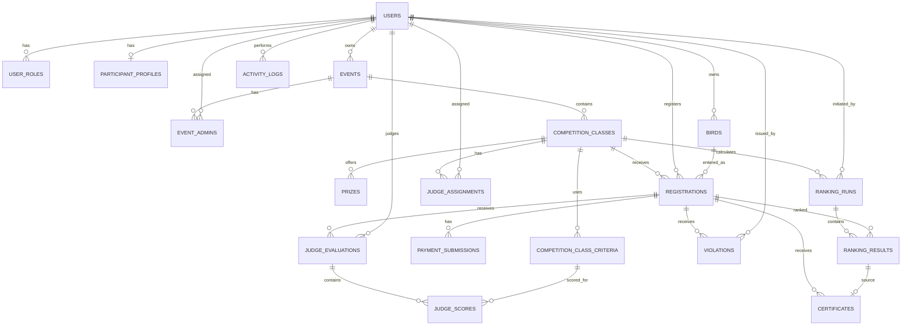
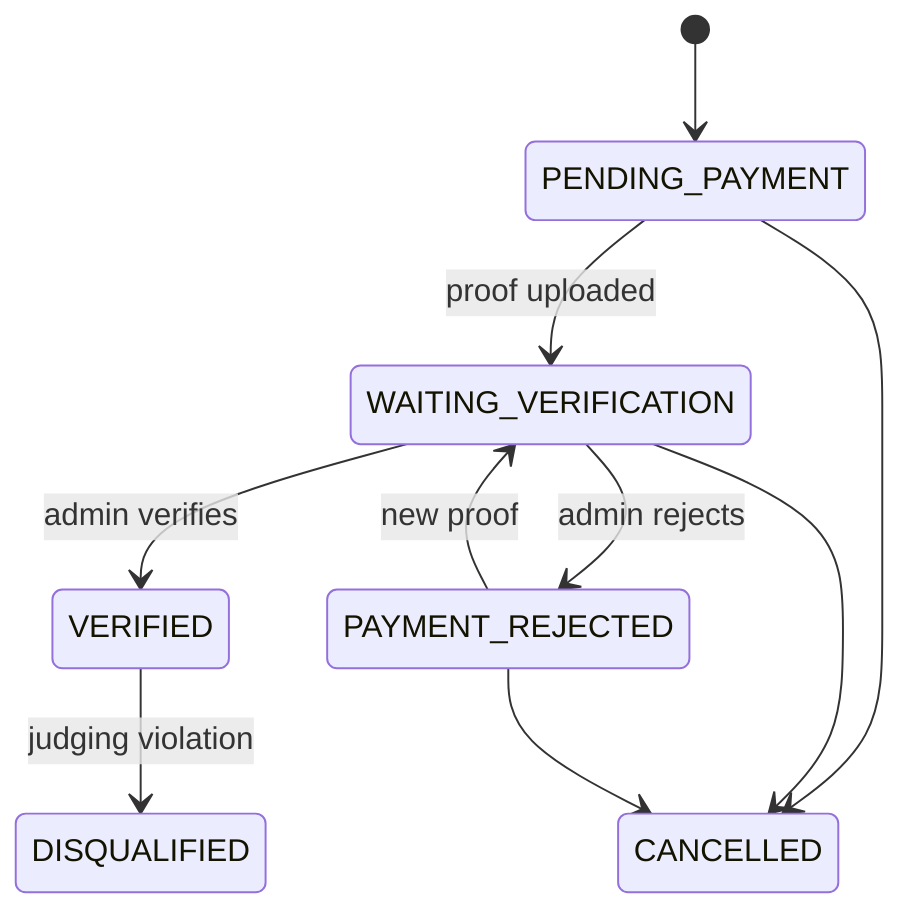
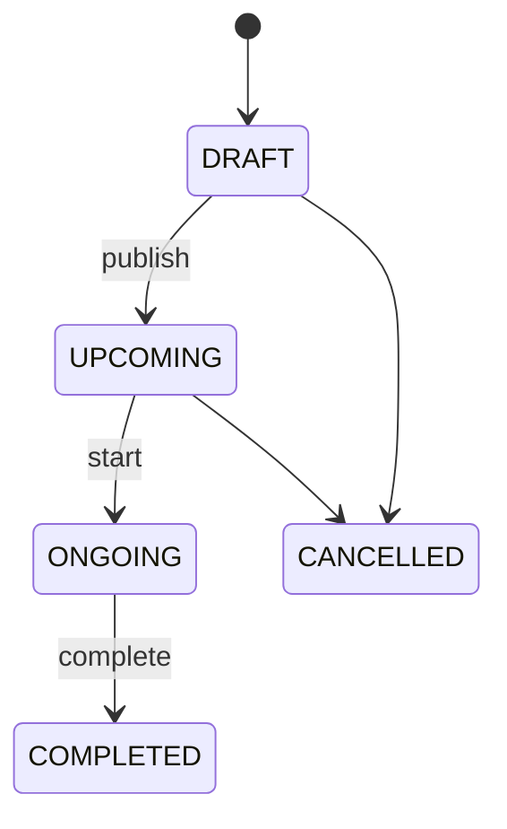
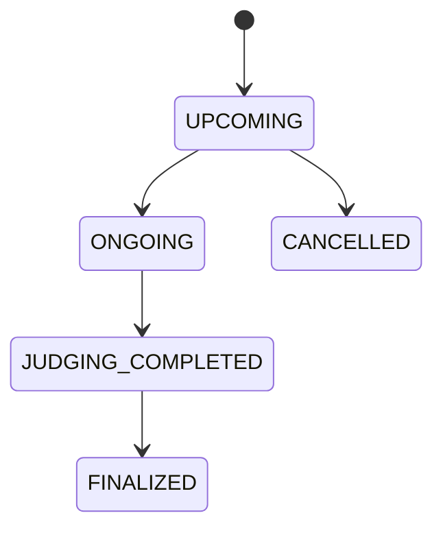
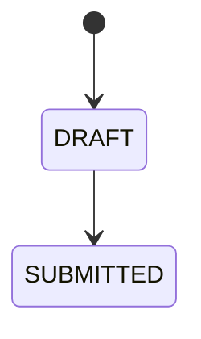
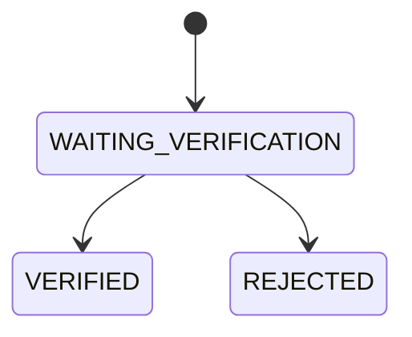
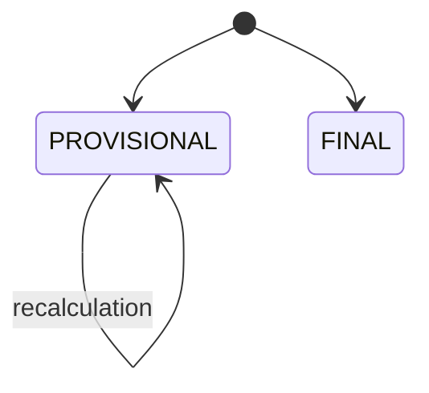

# Schema.md — GantangScore Database Schema

> **Purpose**
>
> Dokumen ini adalah kontrak struktur database GantangScore untuk developer dan AI coding agent seperti Codex. dan isinya bisa berubah tergantung bagusnya bagaimana dan sesuai permintaan kalau ada revisi
>
> Sebelum membuat atau mengubah migration, model, relationship, factory, seeder, query, atau constraint, agent WAJIB membaca:
>
> 1. `PRD.md` — business rules.
> 2. `Design.md` — kebutuhan UI/UX.
> 3. `Architecture.md` — boundary dan technical rules.
> 4. `Schema.md` — struktur database resmi.
>
> Jika terdapat konflik:
>
> - Requirement bisnis: `PRD.md`
> - Struktur teknis: `Architecture.md`
> - Struktur database: `Schema.md`
>
> Agent **tidak boleh membuat kolom/tabel/relasi baru secara diam-diam** hanya karena terasa nyaman. Tambahkan hanya jika benar-benar dibutuhkan requirement atau implementasi yang disetujui.

---

# 1. Database Overview

**Database Engine:** MySQL
**Character Set:** `utf8mb4`
**Collation:** gunakan default Laravel/MySQL yang mendukung `utf8mb4`
**Application Timezone:** `Asia/Jakarta`

Architecture:

```text
One Laravel Application
        │
        ▼
      MySQL
        │
        ├── Authentication
        ├── Event Management
        ├── Classes
        ├── Participants / Birds
        ├── Registration
        ├── Payment Verification
        ├── Judge Assignment
        ├── Judging
        ├── Violations
        ├── TOPSIS Ranking
        ├── Certificates
        └── Activity Logs
```

---

# 2. Core Principles

## DB-001 — Historical Data Must Stay Reproducible

Data event lama tidak boleh berubah hanya karena konfigurasi baru berubah.

Karena itu gunakan snapshot untuk:

```text
registration_fee_snapshot
criteria snapshot per class
ranking input snapshot
ranking criteria snapshot
final ranking results
```

---

## DB-002 — Do Not Delete Critical Competition History

Jangan hard-delete:

```text
verified registrations
submitted judge scores
violations
final ranking runs
final ranking results
payment verification history
certificates
```

Jika data tidak lagi aktif, gunakan status.

---

## DB-003 — Rejected Payment Proof Must Be Preserved

Satu registration dapat mempunyai beberapa:

```text
payment_submissions
```

Bukti baru **tidak overwrite** bukti sebelumnya.

---

## DB-004 — Final Ranking Is Snapshot-Based

Ranking final tidak hanya menyimpan:

```text
rank = 1
```

Tetapi juga:

- nilai rata-rata per kriteria,
- ideal distance,
- preference value,
- criteria configuration,
- input snapshot.

---

## DB-005 — Global Role != Resource Access

`ADMIN` di `user_roles` tidak berarti admin boleh membuka seluruh event.

Akses event berasal dari:

```text
event_admins
```

Juri hanya boleh menilai kelas dari:

```text
judge_assignments
```

---

# 3. Naming Convention

## Table

```text
snake_case
plural
```

Examples:

```text
users
events
competition_classes
judge_scores
```

---

## Primary Key

```text
id
```

Recommended Laravel type:

```php
$table->id();
```

---

## Foreign Key

```text
{entity}_id
```

Examples:

```text
event_id
participant_id
judge_id
registration_id
```

---

## Timestamps

Standard:

```text
created_at
updated_at
```

Business timestamps:

```text
registered_at
uploaded_at
reviewed_at
submitted_at
verified_at
disqualified_at
published_at
calculated_at
finalized_at
generated_at
```

---

# 4. Schema Map

Main tables:

```text
users
user_roles
participant_profiles

events
event_admins

competition_classes
competition_class_criteria
prizes

birds
registrations

payment_submissions

judge_assignments
judge_evaluations
judge_scores

violations

ranking_runs
ranking_results

certificates

activity_logs
```

Laravel system tables when required:

```text
password_reset_tokens
sessions
cache
cache_locks
jobs
job_batches
failed_jobs
```

---

# 5. Entity Relationship Diagram



---

# 6. Relationship Summary

```text
User
├── many Roles
├── optional ParticipantProfile
├── owns many Events
├── admin of many Events
├── owns many Birds
├── participant in many Registrations
├── assigned as Judge to many Classes
├── performs many JudgeEvaluations
├── creates many Violations
├── may initiate RankingRuns
└── produces ActivityLogs

Event
├── belongs to Owner(User)
├── has many EventAdmins
└── has many CompetitionClasses

CompetitionClass
├── belongs to Event
├── has many Criteria
├── has many Prizes
├── has many Registrations
├── has many JudgeAssignments
└── has many RankingRuns

Registration
├── belongs to CompetitionClass
├── belongs to Participant(User)
├── belongs to Bird
├── has many PaymentSubmissions
├── has many JudgeEvaluations
├── has many Violations
├── has many RankingResults
└── may have Certificate
```

---

# 7. Table: users

Purpose:

Menyimpan seluruh account:

```text
Owner
Admin
Judge
Participant
```

Schema:

| Column            | Type            | Null | Constraint     | Description       |
| ----------------- | --------------- | ---: | -------------- | ----------------- |
| id                | BIGINT UNSIGNED |   No | PK             | User ID           |
| name              | VARCHAR(150)    |   No |                | Full/display name |
| email             | VARCHAR(255)    |   No | UNIQUE         | Login email       |
| phone             | VARCHAR(30)     |  Yes | INDEX optional | Phone             |
| password          | VARCHAR(255)    |   No |                | Password hash     |
| status            | VARCHAR(30)     |   No | INDEX          | Account status    |
| email_verified_at | TIMESTAMP       |  Yes |                | Laravel auth      |
| remember_token    | VARCHAR(100)    |  Yes |                | Laravel auth      |
| created_at        | TIMESTAMP       |  Yes |                |                   |
| updated_at        | TIMESTAMP       |  Yes |                |                   |

Recommended status enum:

```text
ACTIVE
INACTIVE
SUSPENDED
```

Default:

```text
ACTIVE
```

Indexes:

```text
UNIQUE(email)
INDEX(status)
```

Eloquent:

```php
hasMany(UserRole::class)
hasOne(ParticipantProfile::class)
hasMany(Event::class, 'owner_id')
hasMany(Bird::class, 'owner_id')
hasMany(Registration::class, 'participant_id')
hasMany(JudgeAssignment::class, 'judge_id')
```

Delete rule:

**RESTRICT** if user already has competition history.

Do not cascade-delete historical records.

---

# 8. Table: user_roles

Purpose:

Global capabilities.

Schema:

| Column     | Type            | Null | Constraint  |
| ---------- | --------------- | ---: | ----------- |
| id         | BIGINT UNSIGNED |   No | PK          |
| user_id    | BIGINT UNSIGNED |   No | FK users.id |
| role       | VARCHAR(30)     |   No |             |
| created_at | TIMESTAMP       |  Yes |             |
| updated_at | TIMESTAMP       |  Yes |             |

Allowed roles:

```text
OWNER
ADMIN
JUDGE
PARTICIPANT
```

Constraints:

```text
UNIQUE(user_id, role)
INDEX(role)
```

Foreign key:

```text
user_id → users.id
ON DELETE CASCADE
```

Cascade is acceptable because removing a truly unused account removes its role rows only.

---

# 9. Table: participant_profiles

Purpose:

Private participant profile extension.

| Column      | Type            | Null | Description  |
| ----------- | --------------- | ---: | ------------ |
| id          | BIGINT UNSIGNED |   No | PK           |
| user_id     | BIGINT UNSIGNED |   No | FK           |
| address     | TEXT            |  Yes | Full address |
| city        | VARCHAR(100)    |  Yes |              |
| province    | VARCHAR(100)    |  Yes |              |
| postal_code | VARCHAR(20)     |  Yes |              |
| created_at  | TIMESTAMP       |  Yes |              |
| updated_at  | TIMESTAMP       |  Yes |              |

Constraint:

```text
UNIQUE(user_id)
```

Foreign key:

```text
user_id → users.id
ON DELETE CASCADE
```

Privacy:

Do not expose `address`, `city`, `province`, `postal_code` on public competition page unless requirement changes.

---

# 10. Table: events

Purpose:

Top-level competition event.

| Column                | Type            | Null | Constraint |
| --------------------- | --------------- | ---: | ---------- |
| id                    | BIGINT UNSIGNED |   No | PK         |
| owner_id              | BIGINT UNSIGNED |   No | FK users   |
| name                  | VARCHAR(200)    |   No |            |
| slug                  | VARCHAR(220)    |   No | UNIQUE     |
| description           | TEXT            |  Yes |            |
| banner_path           | VARCHAR(500)    |  Yes |            |
| location_name         | VARCHAR(200)    |   No |            |
| address               | TEXT            |   No |            |
| registration_open_at  | DATETIME        |  Yes |            |
| registration_close_at | DATETIME        |  Yes |            |
| start_at              | DATETIME        |   No | INDEX      |
| end_at                | DATETIME        |  Yes |            |
| contact_person        | VARCHAR(150)    |  Yes |            |
| contact_phone         | VARCHAR(30)     |  Yes |            |
| status                | VARCHAR(30)     |   No | INDEX      |
| published_at          | DATETIME        |  Yes |            |
| created_at            | TIMESTAMP       |  Yes |            |
| updated_at            | TIMESTAMP       |  Yes |            |

Status:

```text
DRAFT
UPCOMING
ONGOING
COMPLETED
CANCELLED
```

Indexes:

```text
UNIQUE(slug)
INDEX(owner_id)
INDEX(status)
INDEX(start_at)
INDEX(status, start_at)
```

Foreign key:

```text
owner_id → users.id
ON DELETE RESTRICT
```

Validation:

```text
end_at >= start_at
registration_close_at >= registration_open_at
```

Cross-column rules should primarily be application validation because MySQL/Laravel compatibility may vary.

---

# 11. Table: event_admins

Purpose:

Many-to-many assignment Admin ↔ Event.

| Column     | Type            | Null |
| ---------- | --------------- | ---: |
| id         | BIGINT UNSIGNED |   No |
| event_id   | BIGINT UNSIGNED |   No |
| user_id    | BIGINT UNSIGNED |   No |
| created_at | TIMESTAMP       |  Yes |
| updated_at | TIMESTAMP       |  Yes |

Constraints:

```text
UNIQUE(event_id, user_id)
INDEX(user_id)
```

Foreign keys:

```text
event_id → events.id
ON DELETE CASCADE

user_id → users.id
ON DELETE RESTRICT
```

Reason event cascade:

If a DRAFT event with no history is deleted, assignment can disappear.

In production, prefer preventing deletion once event has operational data.

---

# 12. Table: competition_classes

Purpose:

Competition class within an event.

Examples:

```text
Murai Batu Utama
Murai Batu Eksekutif
Kacer A
Cucak Hijau Utama
```

Schema:

| Column           | Type            | Null | Description        |
| ---------------- | --------------- | ---: | ------------------ |
| id               | BIGINT UNSIGNED |   No | PK                 |
| event_id         | BIGINT UNSIGNED |   No | FK                 |
| name             | VARCHAR(180)    |   No |                    |
| slug             | VARCHAR(200)    |   No | Class URL slug     |
| bird_type        | VARCHAR(120)    |   No | Required bird type |
| description      | TEXT            |  Yes |                    |
| registration_fee | BIGINT UNSIGNED |   No | Current class fee  |
| quota            | INT UNSIGNED    |  Yes | Null = unlimited   |
| start_at         | DATETIME        |   No |                    |
| end_at           | DATETIME        |  Yes |                    |
| status           | VARCHAR(30)     |   No |                    |
| created_at       | TIMESTAMP       |  Yes |                    |
| updated_at       | TIMESTAMP       |  Yes |                    |

Status:

```text
UPCOMING
ONGOING
JUDGING_COMPLETED
FINALIZED
CANCELLED
```

Constraints:

```text
UNIQUE(event_id, slug)
INDEX(event_id, status)
INDEX(bird_type)
```

Foreign key:

```text
event_id → events.id
ON DELETE RESTRICT
```

Do not delete class with registrations.

---

# 13. Table: competition_class_criteria

Purpose:

Criteria snapshot for each class.

MVP default:

```text
C1 Irama Lagu           0.40
C2 Durasi Kerja         0.20
C3 Volume               0.20
C4 Gaya                 0.10
C5 Fisik                0.10
```

Schema:

| Column               | Type              | Null |
| -------------------- | ----------------- | ---: |
| id                   | BIGINT UNSIGNED   |   No |
| competition_class_id | BIGINT UNSIGNED   |   No |
| code                 | VARCHAR(20)       |   No |
| name                 | VARCHAR(120)      |   No |
| weight               | DECIMAL(8,6)      |   No |
| type                 | VARCHAR(20)       |   No |
| min_score            | TINYINT UNSIGNED  |   No |
| max_score            | TINYINT UNSIGNED  |   No |
| sort_order           | SMALLINT UNSIGNED |   No |
| created_at           | TIMESTAMP         |  Yes |
| updated_at           | TIMESTAMP         |  Yes |

Criterion type:

```text
BENEFIT
COST
```

MVP values all:

```text
BENEFIT
```

Default score:

```text
min_score = 1
max_score = 10
```

Constraints:

```text
UNIQUE(competition_class_id, code)
UNIQUE(competition_class_id, sort_order)
INDEX(competition_class_id)
```

Foreign key:

```text
competition_class_id → competition_classes.id
ON DELETE RESTRICT
```

Application invariant:

```text
SUM(weight) = 1.000000
```

Do not edit criteria after judging has started.

---

# 14. Criteria Seed Template

Whenever a new competition class is created, create 5 rows:

| Code | Name                      |   Weight | Type    | Min | Max | Order |
| ---- | ------------------------- | -------: | ------- | --: | --: | ----: |
| C1   | Irama Lagu                | 0.400000 | BENEFIT |   1 |  10 |     1 |
| C2   | Durasi Kerja / Kestabilan | 0.200000 | BENEFIT |   1 |  10 |     2 |
| C3   | Volume                    | 0.200000 | BENEFIT |   1 |  10 |     3 |
| C4   | Gaya                      | 0.100000 | BENEFIT |   1 |  10 |     4 |
| C5   | Fisik                     | 0.100000 | BENEFIT |   1 |  10 |     5 |

This is class snapshot.

Do not keep a single global mutable criterion table as the only source.

---

# 15. Table: prizes

Purpose:

Prize per rank per class.

| Column               | Type              | Null |
| -------------------- | ----------------- | ---: |
| id                   | BIGINT UNSIGNED   |   No |
| competition_class_id | BIGINT UNSIGNED   |   No |
| rank                 | SMALLINT UNSIGNED |   No |
| type                 | VARCHAR(20)       |   No |
| title                | VARCHAR(180)      |   No |
| description          | TEXT              |  Yes |
| cash_amount          | BIGINT UNSIGNED   |  Yes |
| created_at           | TIMESTAMP         |  Yes |
| updated_at           | TIMESTAMP         |  Yes |

Types:

```text
CASH
ITEM
OTHER
```

Constraints:

```text
UNIQUE(competition_class_id, rank)
```

Foreign key:

```text
competition_class_id → competition_classes.id
ON DELETE RESTRICT
```

Rule:

For `CASH`:

```text
cash_amount required
```

For `ITEM`:

```text
cash_amount null allowed
title required
```

---

# 16. Table: birds

Purpose:

Participant-owned bird profile.

| Column      | Type            | Null |
| ----------- | --------------- | ---: |
| id          | BIGINT UNSIGNED |   No |
| owner_id    | BIGINT UNSIGNED |   No |
| name        | VARCHAR(150)    |   No |
| bird_type   | VARCHAR(120)    |   No |
| photo_path  | VARCHAR(500)    |  Yes |
| description | TEXT            |  Yes |
| created_at  | TIMESTAMP       |  Yes |
| updated_at  | TIMESTAMP       |  Yes |

Indexes:

```text
INDEX(owner_id)
INDEX(bird_type)
```

Foreign key:

```text
owner_id → users.id
ON DELETE RESTRICT
```

Do not delete a bird that has competition history.

Use archival behavior later if needed.

---

# 17. Table: registrations

Purpose:

One competition entry:

```text
1 participant
+
1 bird
+
1 class
```

Schema:

| Column                    | Type            | Null | Description         |
| ------------------------- | --------------- | ---: | ------------------- |
| id                        | BIGINT UNSIGNED |   No |                     |
| competition_class_id      | BIGINT UNSIGNED |   No |                     |
| participant_id            | BIGINT UNSIGNED |   No |                     |
| bird_id                   | BIGINT UNSIGNED |   No |                     |
| registration_number       | VARCHAR(60)     |   No | Public/human ID     |
| gantangan_number          | VARCHAR(50)     |  Yes | Participant choice; legacy nullable |
| registration_fee_snapshot | BIGINT UNSIGNED |   No | Fee at registration |
| status                    | VARCHAR(40)     |   No |                     |
| registered_at             | DATETIME        |   No |                     |
| verified_at               | DATETIME        |  Yes |                     |
| disqualified_at           | DATETIME        |  Yes |                     |
| created_at                | TIMESTAMP       |  Yes |                     |
| updated_at                | TIMESTAMP       |  Yes |                     |

Status:

```text
PENDING_PAYMENT
WAITING_VERIFICATION
VERIFIED
PAYMENT_REJECTED
CANCELLED
DISQUALIFIED
```

Constraints:

```text
UNIQUE(registration_number)
UNIQUE(competition_class_id, gantangan_number)
INDEX(competition_class_id, status)
INDEX(participant_id)
INDEX(bird_id)
INDEX(gantangan_number)
```

Foreign keys:

```text
competition_class_id → competition_classes.id
ON DELETE RESTRICT

participant_id → users.id
ON DELETE RESTRICT

bird_id → birds.id
ON DELETE RESTRICT
```

Important:

Do **not** add:

```text
UNIQUE(bird_id, event_id)
```

or equivalent yet.

Open question:

Same bird joining multiple classes is unresolved.

---

# 18. Registration Number

Recommended format:

```text
REG-2026-000001
```

Database guarantee:

```text
UNIQUE(registration_number)
```

Do not generate using:

```text
count() + 1
```

Use collision-safe generator.

---

# 19. Gantangan Number

Column:

```text
gantangan_number VARCHAR(50) NULL
```

Reason nullable:

Legacy registrations may not have a number. New participant registrations require a chosen number under the approved rule below.

No global UNIQUE constraint. User decision, 29 Oktober 2026: enforce:

```text
competition_class_id + gantangan_number
```

Migration `2026_10_29_205837_add_unique_gantangan_number_per_class_to_registrations_table.php` adds `registrations_class_gantangan_unique`. Null values remain allowed for historical rows; MySQL permits multiple nulls. All statuses reserve a non-null number within the class. Fresh values are canonical positive digit strings, maximum 50 characters; leading zeros are stripped before persistence. Existing zero-padded numbers are treated as occupied without rewriting historical values.

The migration checks for duplicate class/canonical-number groups first and stops for manual review if found; it does not delete or reassign history. Application actions lock the class before checking and saving, with the unique index as an additional database boundary. A missing legacy number can be filled once before judging; filled numbers and FINAL snapshots are not edited. Registration fee/payment status is unaffected.

---

# 20. Table: payment_submissions

Implementasi Tahap 4 memakai migration `2026_10_21_205259_create_payment_submissions_table.php` sesuai kontrak tabel di bawah. Bukti disimpan sebagai path relatif pada disk `private`. Batas satu percobaan aktif ditegakkan melalui transaksi dan penguncian kelas, pendaftaran, lalu pembayaran; tidak menambah kolom event atau menimpa percobaan lama.

Purpose:

Payment proof attempts.

Schema:

| Column           | Type            | Null |
| ---------------- | --------------- | ---: |
| id               | BIGINT UNSIGNED |   No |
| registration_id  | BIGINT UNSIGNED |   No |
| amount           | BIGINT UNSIGNED |   No |
| proof_path       | VARCHAR(500)    |   No |
| status           | VARCHAR(40)     |   No |
| uploaded_at      | DATETIME        |   No |
| reviewed_by      | BIGINT UNSIGNED |  Yes |
| reviewed_at      | DATETIME        |  Yes |
| rejection_reason | TEXT            |  Yes |
| created_at       | TIMESTAMP       |  Yes |
| updated_at       | TIMESTAMP       |  Yes |

Status:

```text
WAITING_VERIFICATION
VERIFIED
REJECTED
```

Indexes:

```text
INDEX(registration_id, status)
INDEX(reviewed_by)
INDEX(status)
```

Foreign keys:

```text
registration_id → registrations.id
ON DELETE RESTRICT

reviewed_by → users.id
ON DELETE SET NULL
```

Application constraint:

One registration should have max one active:

```text
WAITING_VERIFICATION
```

at a time.

MySQL partial unique index is not used for this MVP; enforce transactionally.

---

# 21. Payment Attempt Example

```text
Registration #100

payment_submissions

#1
Rp150.000
REJECTED
"Foto blur"

#2
Rp150.000
REJECTED
"Nominal tidak sesuai"

#3
Rp150.000
VERIFIED
```

Do not overwrite #1 or #2.

---

# 22. Table: judge_assignments

Tahap 7 menambahkan migration `2026_10_21_222754_add_replacement_history_to_judge_assignments_table.php`: `replaced_at DATETIME NULL`, `replacement_assignment_id BIGINT UNSIGNED NULL` (FK self, RESTRICT), `replacement_note TEXT NULL`. Penugasan aktif adalah `replaced_at IS NULL`. Keunikan kelas/Juri tetap dipertahankan; penugasan lama tidak dihapus atau diaktifkan ulang. Draft lama tidak diwariskan ke pengganti.

Implementasi Tahap 5: `2026_10_21_212524_create_judge_assignments_table.php`. Penugasan unik per kelas/Juri; tidak membuat tabel autentikasi terpisah. Indeks `judge_id` didukung foreign key MySQL.

Purpose:

Which judge can judge which class.

| Column               | Type            | Null |
| -------------------- | --------------- | ---: |
| id                   | BIGINT UNSIGNED |   No |
| competition_class_id | BIGINT UNSIGNED |   No |
| judge_id             | BIGINT UNSIGNED |   No |
| created_at           | TIMESTAMP       |  Yes |
| updated_at           | TIMESTAMP       |  Yes |

Constraints:

```text
UNIQUE(competition_class_id, judge_id)
INDEX(judge_id)
```

Foreign keys:

```text
competition_class_id → competition_classes.id
ON DELETE RESTRICT

judge_id → users.id
ON DELETE RESTRICT
```

---

# 23. Table: judge_evaluations

Implementasi Tahap 5: `2026_10_21_212527_create_judge_evaluations_table.php`. Status memakai enum PHP `EvaluationStatus`; waktu submit ditetapkan server. Indeks komposit kelas tidak ditambahkan karena kelas ditelusuri melalui pendaftaran.

Purpose:

Header for a judge evaluation.

One row means:

```text
one judge evaluates one registration
```

Schema:

| Column          | Type            | Null |
| --------------- | --------------- | ---: |
| id              | BIGINT UNSIGNED |   No |
| registration_id | BIGINT UNSIGNED |   No |
| judge_id        | BIGINT UNSIGNED |   No |
| status          | VARCHAR(30)     |   No |
| submitted_at    | DATETIME        |  Yes |
| created_at      | TIMESTAMP       |  Yes |
| updated_at      | TIMESTAMP       |  Yes |

Status:

```text
DRAFT
SUBMITTED
```

Constraints:

```text
UNIQUE(registration_id, judge_id)
INDEX(judge_id, status)
INDEX(registration_id, status)
```

Foreign keys:

```text
registration_id → registrations.id
ON DELETE RESTRICT

judge_id → users.id
ON DELETE RESTRICT
```

---

# 24. Table: judge_scores

Implementasi Tahap 5: `2026_10_21_212529_create_judge_scores_table.php`. Kriteria harus berasal dari kelas pendaftaran evaluasi. Nilai disimpan sebagai integer dalam rentang snapshot 1-10. Batas unik berlaku per evaluasi/kriteria dan indeks kriteria didukung foreign key MySQL.

Purpose:

Per-criterion score within an evaluation.

Schema:

| Column              | Type             | Null |
| ------------------- | ---------------- | ---: |
| id                  | BIGINT UNSIGNED  |   No |
| judge_evaluation_id | BIGINT UNSIGNED  |   No |
| criterion_id        | BIGINT UNSIGNED  |   No |
| score               | TINYINT UNSIGNED |   No |
| created_at          | TIMESTAMP        |  Yes |
| updated_at          | TIMESTAMP        |  Yes |

Constraint:

```text
UNIQUE(judge_evaluation_id, criterion_id)
INDEX(criterion_id)
```

Foreign keys:

```text
judge_evaluation_id → judge_evaluations.id
ON DELETE RESTRICT

criterion_id → competition_class_criteria.id
ON DELETE RESTRICT
```

Business validation:

```text
criterion.min_score <= score <= criterion.max_score
```

MVP:

```text
1 <= score <= 10
```

---

# 25. Evaluation Data Example

```text
judge_evaluations

ID: 501
registration_id: 100
judge_id: 7
status: SUBMITTED

judge_scores

C1 = 9
C2 = 8
C3 = 9
C4 = 7
C5 = 8
```

Do not store:

```text
irama_score
durasi_score
volume_score
gaya_score
fisik_score
```

as fixed columns in `judge_evaluations`.

Normalized `judge_scores` is preferred because criteria snapshot exists.

---

# 26. Table: violations

Purpose:

Warning and disqualification history.

Implementasi Tahap 6: `2026_10_21_215252_create_violations_table.php`, model `Violation`, enum `ViolationAction` dan `ViolationReasonCode`. Foreign key `judge_id` menyediakan indeks Juri pada MySQL; indeks komposit pendaftaran/tindakan dan indeks alasan dibuat eksplisit. Tidak ada `event_id` redundan, tabel reversal, atau perubahan nilai setelah DQ. `reason` menyimpan label alasan saat kejadian; `OTHER` menyimpan penjelasan petugas. Catatan wajib untuk semua DQ, termasuk eskalasi, dan opsional untuk peringatan pertama.

Schema:

| Column          | Type            |            Null |
| --------------- | --------------- | --------------: |
| id              | BIGINT UNSIGNED |              No |
| registration_id | BIGINT UNSIGNED |              No |
| judge_id        | BIGINT UNSIGNED |              No |
| action          | VARCHAR(30)     |              No |
| reason_code     | VARCHAR(60)     |              No |
| reason          | VARCHAR(255)    |              No |
| note            | TEXT            | Yes/Conditional |
| created_at      | TIMESTAMP       |             Yes |
| updated_at      | TIMESTAMP       |             Yes |

Actions:

```text
WARNING
DISQUALIFICATION
```

Reason codes initial:

```text
SHOUTING
PROVOCATION
DISTURBING
LATE_HANGING
NUMBER_MANIPULATION
OTHER
```

Indexes:

```text
INDEX(registration_id, action)
INDEX(judge_id)
INDEX(reason_code)
```

Foreign keys:

```text
registration_id → registrations.id
ON DELETE RESTRICT

judge_id → users.id
ON DELETE RESTRICT
```

Rule:

Disqualification requires note.

Recommended:

Warning also supports note but may be nullable depending UI.

---

# 27. Violation History Example

```text
Registration 100

2026-09-16 10:10
WARNING
SHOUTING

2026-09-16 10:22
DISQUALIFICATION
PROVOCATION
"Peserta kembali melakukan pelanggaran setelah peringatan."
```

All history remains stored.

---

# 28. Table: ranking_runs

Implementasi Tahap 7: migration `2026_10_21_222748_create_ranking_runs_table.php`. Selain kontrak dasar, menyimpan `algorithm VARCHAR(30)`, `algorithm_version VARCHAR(30)`, `source_hash CHAR(64)`, dan `calculation_snapshot JSON`, semuanya wajib. Hash mengikat snapshot kriteria, daftar Juri, peserta eligible, nilai submitted, identitas publik, serta hadiah. Snapshot calculation memuat matriks, normalisasi, ideal, hasil TOPSIS asli, dan salinan keputusan draw pada FINAL. Run bersifat append-only.

Purpose:

One TOPSIS calculation execution.

Each run belongs to one competition class.

Schema:

| Column               | Type            | Null |
| -------------------- | --------------- | ---: |
| id                   | BIGINT UNSIGNED |   No |
| competition_class_id | BIGINT UNSIGNED |   No |
| type                 | VARCHAR(20)     |   No |
| status               | VARCHAR(20)     |   No |
| criteria_snapshot    | JSON            |   No |
| input_snapshot       | JSON            |   No |
| calculated_at        | DATETIME        |   No |
| finalized_at         | DATETIME        |  Yes |
| created_by           | BIGINT UNSIGNED |  Yes |
| created_at           | TIMESTAMP       |  Yes |
| updated_at           | TIMESTAMP       |  Yes |

Run type:

```text
PROVISIONAL
FINAL
```

Run status:

```text
COMPLETED
FAILED
```

Indexes:

```text
INDEX(competition_class_id, type, calculated_at)
INDEX(status)
INDEX(created_by)
```

Foreign keys:

```text
competition_class_id → competition_classes.id
ON DELETE RESTRICT

created_by → users.id
ON DELETE SET NULL
```

---

# 29. ranking_runs.criteria_snapshot

Example:

```json
[
  {
    "id": 1,
    "code": "C1",
    "name": "Irama Lagu",
    "weight": "0.400000",
    "type": "BENEFIT",
    "min_score": 1,
    "max_score": 10
  },
  {
    "id": 2,
    "code": "C2",
    "name": "Durasi Kerja / Kestabilan",
    "weight": "0.200000",
    "type": "BENEFIT",
    "min_score": 1,
    "max_score": 10
  }
]
```

Snapshot must be self-contained enough to reproduce calculation.

---

# 30. ranking_runs.input_snapshot

Format implementasi Tahap 7 adalah object versioned oleh `algorithm_version`, bukan sekadar daftar: `{minimum_judges, judge_ids, class, prizes, registrations}`. Setiap registration menyimpan ID burung/pendaftaran, identitas publik saat perhitungan, rata-rata presisi penuh, serta daftar `{id, judge_id, submitted_at, scores}` untuk setiap evaluasi submitted yang dipakai. Tidak menyimpan kontak privat/pembayaran/catatan Juri. Halaman publik menerima proyeksi terpisah, bukan object ini.

Example:

```json
[
  {
    "registration_id": 100,
    "bird_id": 50,
    "averages": {
      "C1": 9.0000,
      "C2": 8.3333,
      "C3": 9.0000,
      "C4": 8.0000,
      "C5": 8.3333
    },
    "judge_evaluation_ids": [501, 510, 519]
  }
]
```

Do not store payment/private profile data in ranking snapshot.

---

# 31. Table: ranking_results

Implementasi Tahap 7: migration `2026_10_21_222750_create_ranking_results_table.php`. `entry_snapshot JSON NOT NULL` menyimpan nama burung/peserta, jenis burung, nomor pendaftaran/gantangan untuk sejarah tampilan; halaman final tidak memakai identitas live. `rank` menggunakan **INT UNSIGNED nullable**, menggantikan rekomendasi SMALLINT agar konsisten dengan kuota kelas sampai 100.000. Angka hasil tetap DECIMAL(16,10). Hasil tidak dapat diperbarui/dihapus melalui model/domain.

Purpose:

Per-participant result inside a ranking run.

Schema:

| Column             | Type              | Null |
| ------------------ | ----------------- | ---: |
| id                 | BIGINT UNSIGNED   |   No |
| ranking_run_id     | BIGINT UNSIGNED   |   No |
| registration_id    | BIGINT UNSIGNED   |   No |
| criterion_averages | JSON              |   No |
| positive_distance  | DECIMAL(16,10)    |   No |
| negative_distance  | DECIMAL(16,10)    |   No |
| preference_value   | DECIMAL(16,10)    |   No |
| rank               | INT UNSIGNED      |  Yes |
| is_tied            | BOOLEAN           |   No |
| created_at         | TIMESTAMP         |  Yes |
| updated_at         | TIMESTAMP         |  Yes |

Constraints:

```text
UNIQUE(ranking_run_id, registration_id)
INDEX(ranking_run_id, rank)
INDEX(registration_id)
```

Foreign keys:

```text
ranking_run_id → ranking_runs.id
ON DELETE CASCADE

registration_id → registrations.id
ON DELETE RESTRICT
```

Why ranking run cascade?

A provisional ranking run may be intentionally pruned later.

However:

**Never delete FINAL ranking run.**

Application/service must enforce.

---

# 32. Criterion Averages Example

```json
{
  "C1": 9.0000,
  "C2": 8.3333,
  "C3": 9.0000,
  "C4": 8.0000,
  "C5": 8.3333
}
```

UI can map code using criteria snapshot from ranking run.

---

# 33. Rank and Tie

Keputusan Owner Tahap 7 menggantikan status OPEN di uraian awal berikut: hasil matematis seri tetap diarsipkan dengan shared competition rank (1,1,3) dan `is_tied=true`. Urutan FINAL berasal dari catatan lempar dadu nyata oleh Admin, hanya di dalam kelompok seri. Koefisien yang sama pada presisi penyimpanan 10 desimal dikelompokkan sebagai draw. Semua draw wajib diselesaikan sebelum finalisasi.

Tabel baru `ranking_tie_resolutions` (migration `2026_10_21_222752_create_ranking_tie_resolutions_table.php`):

| Column | Type | Null |
| --- | --- | --- |
| id | BIGINT UNSIGNED PK | No |
| ranking_run_id | BIGINT UNSIGNED FK ranking_runs, RESTRICT | No |
| group_key | CHAR(64), hash kelompok ID peserta seri | No |
| ordered_registration_ids | JSON, urutan hasil undian asli | No |
| note | TEXT, catatan kejadian/total dadu di lokasi | No |
| created_by | BIGINT UNSIGNED FK users, RESTRICT | No |
| created_at / updated_at | TIMESTAMP | Yes |

UNIQUE(ranking_run_id, group_key). Keputusan append-only dan dicatat Admin server-side. FINAL menyalin keputusan yang hash sumbernya masih cocok ke `calculation_snapshot.draw_resolutions`; keputusan lama tidak dihapus bila sumber berubah. Tidak ada kolom manual override rank di registration atau perubahan skor untuk menyelesaikan draw.

If ranking is deterministic and no tie:

```text
rank = 1
is_tied = false
```

If equal TOPSIS value and no tie-break rule:

```text
rank = nullable or shared-rank based on service policy
is_tied = true
```

Important:

Approved business tie-break: actual dice outcomes recorded by the assigned Admin. The mathematical draw grouping remains:

```text
same preference at DECIMAL(16,10) precision
→ same rank group / is_tied = true
```

Finalization is blocked while any draw group remains unresolved. Do not invent a winner or apply arbitrary manual reordering outside that group.

---

# 34. Table: certificates

Purpose:

Winner certificate metadata.

Schema:

| Column               | Type              | Null |
| -------------------- | ----------------- | ---: |
| id                   | BIGINT UNSIGNED   |   No |
| event_id             | BIGINT UNSIGNED   |   No |
| competition_class_id | BIGINT UNSIGNED   |   No |
| registration_id      | BIGINT UNSIGNED   |   No |
| ranking_result_id    | BIGINT UNSIGNED   |   No |
| rank                 | INT UNSIGNED      |   No |
| file_path            | VARCHAR(500)      |   No |
| template_version     | VARCHAR(30)       |   No |
| metadata_snapshot    | JSON              |   No |
| generated_at         | DATETIME          |   No |
| created_at           | TIMESTAMP         |  Yes |
| updated_at           | TIMESTAMP         |  Yes |

Constraints:

```text
UNIQUE(ranking_result_id)
INDEX(registration_id)
INDEX(event_id, competition_class_id)
```

Foreign keys:

```text
event_id → events.id
ON DELETE RESTRICT

competition_class_id → competition_classes.id
ON DELETE RESTRICT

registration_id → registrations.id
ON DELETE RESTRICT

ranking_result_id → ranking_results.id
ON DELETE RESTRICT
```

Certificate must reference FINAL ranking result.

Implementasi Tahap 8 (29 Oktober 2026): hanya peringkat hadiah yang tercatat pada `ranking_runs.input_snapshot.prizes` milik run FINAL COMPLETED, dengan kelas FINALIZED. Rank mengikuti urutan resmi setelah keputusan draw, bukan shared rank matematis awal. Policy unduhan memvalidasi rantai result–registration–class–event serta rank sebelum memeriksa pemilik/penugasan.

`metadata_snapshot` menyimpan nomor piagam, nama peserta/burung/jenis, event/kelas, tanggal event, penyelenggara, rank, dan waktu finalisasi. Record piagam immutable. File privat ber-UUID; UNIQUE result mencegah duplikasi. Retry hanya mengembalikan file yang ada atau memulihkan file hilang memakai metadata piagam tersimpan. `CERTIFICATE_GENERATED` dicatat sekali saat penerbitan pertama.

FINAL baru menyimpan `class.event_start_at` dan `class.organizer_name` di input snapshot. FINAL lama Tahap 7 tidak diubah: tanggal event saat penerbitan pertama dan nama aplikasi dipakai bila metadata tersebut belum tersedia, lalu dibekukan dalam metadata piagam. Tanggal historis FINAL lama perlu diperiksa panitia sebelum menjalankan pembuatan piagam.

---

# 35. Table: activity_logs

Purpose:

Business audit log.

Schema:

| Column       | Type            | Null |
| ------------ | --------------- | ---: |
| id           | BIGINT UNSIGNED |   No |
| user_id      | BIGINT UNSIGNED |  Yes |
| action       | VARCHAR(80)     |   No |
| subject_type | VARCHAR(150)    |  Yes |
| subject_id   | BIGINT UNSIGNED |  Yes |
| metadata     | JSON            |  Yes |
| ip_address   | VARCHAR(45)     |  Yes |
| created_at   | TIMESTAMP       |  Yes |

No `updated_at` required if logs are append-only.

Indexes:

```text
INDEX(user_id)
INDEX(action)
INDEX(subject_type, subject_id)
INDEX(created_at)
```

Foreign key:

```text
user_id → users.id
ON DELETE SET NULL
```

Logs must be append-only.

---

# 36. Activity Log Examples

```json
{
  "action": "PAYMENT_VERIFIED",
  "subject_type": "Registration",
  "subject_id": 100,
  "metadata": {
    "payment_submission_id": 22
  }
}
```

```json
{
  "action": "PARTICIPANT_DISQUALIFIED",
  "subject_type": "Registration",
  "subject_id": 100,
  "metadata": {
    "violation_id": 44,
    "reason_code": "NUMBER_MANIPULATION"
  }
}
```

Do not log sensitive binary/file contents.

---

# 37. Laravel Infrastructure Tables

Depending on project configuration.

## password_reset_tokens

Laravel default.

---

## sessions

Use if:

```text
SESSION_DRIVER=database
```

---

## cache

Use if:

```text
CACHE_STORE=database
```

---

## cache_locks

For database locking/cache locking.

---

## jobs

Database queue.

Fields generated by Laravel:

```text
id
queue
payload
attempts
reserved_at
available_at
created_at
```

---

## job_batches

If batch jobs used.

---

## failed_jobs

Required for queue failure visibility.

---

# 38. Full Foreign Key Matrix

| Child Table                | FK                   | Parent                     | On Delete                     |
| -------------------------- | -------------------- | -------------------------- | ----------------------------- |
| user_roles                 | user_id              | users                      | CASCADE                       |
| participant_profiles       | user_id              | users                      | CASCADE                       |
| events                     | owner_id             | users                      | RESTRICT                      |
| event_admins               | event_id             | events                     | CASCADE/Restricted by service |
| event_admins               | user_id              | users                      | RESTRICT                      |
| competition_classes        | event_id             | events                     | RESTRICT                      |
| competition_class_criteria | competition_class_id | competition_classes        | RESTRICT                      |
| prizes                     | competition_class_id | competition_classes        | RESTRICT                      |
| birds                      | owner_id             | users                      | RESTRICT                      |
| registrations              | competition_class_id | competition_classes        | RESTRICT                      |
| registrations              | participant_id       | users                      | RESTRICT                      |
| registrations              | bird_id              | birds                      | RESTRICT                      |
| payment_submissions        | registration_id      | registrations              | RESTRICT                      |
| payment_submissions        | reviewed_by          | users                      | SET NULL                      |
| judge_assignments          | competition_class_id | competition_classes        | RESTRICT                      |
| judge_assignments          | judge_id             | users                      | RESTRICT                      |
| judge_evaluations          | registration_id      | registrations              | RESTRICT                      |
| judge_evaluations          | judge_id             | users                      | RESTRICT                      |
| judge_scores               | judge_evaluation_id  | judge_evaluations          | RESTRICT                      |
| judge_scores               | criterion_id         | competition_class_criteria | RESTRICT                      |
| violations                 | registration_id      | registrations              | RESTRICT                      |
| violations                 | judge_id             | users                      | RESTRICT                      |
| ranking_runs               | competition_class_id | competition_classes        | RESTRICT                      |
| ranking_runs               | created_by           | users                      | SET NULL                      |
| ranking_results            | ranking_run_id       | ranking_runs               | CASCADE                       |
| ranking_results            | registration_id      | registrations              | RESTRICT                      |
| certificates               | event_id             | events                     | RESTRICT                      |
| certificates               | competition_class_id | competition_classes        | RESTRICT                      |
| certificates               | registration_id      | registrations              | RESTRICT                      |
| certificates               | ranking_result_id    | ranking_results            | RESTRICT                      |
| activity_logs              | user_id              | users                      | SET NULL                      |

---

# 39. Recommended Migration Order

Migration ordering matters because of foreign keys.

Recommended:

```text
001_create_users_table
002_create_user_roles_table
003_create_participant_profiles_table

010_create_events_table
011_create_event_admins_table

020_create_competition_classes_table
021_create_competition_class_criteria_table
022_create_prizes_table

030_create_birds_table
031_create_registrations_table

040_create_payment_submissions_table

050_create_judge_assignments_table
051_create_judge_evaluations_table
052_create_judge_scores_table

060_create_violations_table

070_create_ranking_runs_table
071_create_ranking_results_table

080_create_certificates_table

090_create_activity_logs_table
```

Laravel infrastructure migrations can be earlier or generated separately.

---

# 40. Migration Rules for Codex

AI agent must:

```text
1. Never edit an already-deployed migration.
2. Create new migration for schema changes.
3. Include foreign keys and indexes.
4. Use explicit nullable where needed.
5. Avoid string status without application enum.
6. Avoid destructive migration without request.
7. Preserve historical ranking fields.
```

---

# 41. Example Migration — competition_classes

Reference pattern:

```php
Schema::create('competition_classes', function (Blueprint $table) {
    $table->id();

    $table->foreignId('event_id')
        ->constrained()
        ->restrictOnDelete();

    $table->string('name', 180);
    $table->string('slug', 200);
    $table->string('bird_type', 120);

    $table->text('description')->nullable();

    $table->unsignedBigInteger('registration_fee');
    $table->unsignedInteger('quota')->nullable();

    $table->dateTime('start_at');
    $table->dateTime('end_at')->nullable();

    $table->string('status', 30);

    $table->timestamps();

    $table->unique(['event_id', 'slug']);
    $table->index(['event_id', 'status']);
    $table->index('bird_type');
});
```

Use project Laravel syntax/version.

---

# 42. Example Migration — registrations

```php
Schema::create('registrations', function (Blueprint $table) {
    $table->id();

    $table->foreignId('competition_class_id')
        ->constrained()
        ->restrictOnDelete();

    $table->foreignId('participant_id')
        ->constrained('users')
        ->restrictOnDelete();

    $table->foreignId('bird_id')
        ->constrained()
        ->restrictOnDelete();

    $table->string('registration_number', 60)->unique();
    $table->string('gantangan_number', 50)->nullable();

    $table->unsignedBigInteger('registration_fee_snapshot');

    $table->string('status', 40);

    $table->dateTime('registered_at');
    $table->dateTime('verified_at')->nullable();
    $table->dateTime('disqualified_at')->nullable();

    $table->timestamps();

    $table->index(['competition_class_id', 'status']);
    $table->index('participant_id');
    $table->index('bird_id');
    $table->index('gantangan_number');
});
```

---

# 43. Example Migration — payment_submissions

```php
Schema::create('payment_submissions', function (Blueprint $table) {
    $table->id();

    $table->foreignId('registration_id')
        ->constrained()
        ->restrictOnDelete();

    $table->unsignedBigInteger('amount');
    $table->string('proof_path', 500);

    $table->string('status', 40);

    $table->dateTime('uploaded_at');

    $table->foreignId('reviewed_by')
        ->nullable()
        ->constrained('users')
        ->nullOnDelete();

    $table->dateTime('reviewed_at')->nullable();
    $table->text('rejection_reason')->nullable();

    $table->timestamps();

    $table->index(['registration_id', 'status']);
    $table->index('status');
});
```

---

# 44. Example Migration — judge_evaluations

```php
Schema::create('judge_evaluations', function (Blueprint $table) {
    $table->id();

    $table->foreignId('registration_id')
        ->constrained()
        ->restrictOnDelete();

    $table->foreignId('judge_id')
        ->constrained('users')
        ->restrictOnDelete();

    $table->string('status', 30);
    $table->dateTime('submitted_at')->nullable();

    $table->timestamps();

    $table->unique(['registration_id', 'judge_id']);
    $table->index(['judge_id', 'status']);
    $table->index(['registration_id', 'status']);
});
```

---

# 45. Example Migration — judge_scores

```php
Schema::create('judge_scores', function (Blueprint $table) {
    $table->id();

    $table->foreignId('judge_evaluation_id')
        ->constrained()
        ->restrictOnDelete();

    $table->foreignId('criterion_id')
        ->constrained('competition_class_criteria')
        ->restrictOnDelete();

    $table->unsignedTinyInteger('score');

    $table->timestamps();

    $table->unique([
        'judge_evaluation_id',
        'criterion_id',
    ]);
});
```

---

# 46. Example Migration — ranking_runs

```php
Schema::create('ranking_runs', function (Blueprint $table) {
    $table->id();

    $table->foreignId('competition_class_id')
        ->constrained()
        ->restrictOnDelete();

    $table->string('type', 20);
    $table->string('status', 20);

    $table->json('criteria_snapshot');
    $table->json('input_snapshot');

    $table->dateTime('calculated_at');
    $table->dateTime('finalized_at')->nullable();

    $table->foreignId('created_by')
        ->nullable()
        ->constrained('users')
        ->nullOnDelete();

    $table->timestamps();

    $table->index([
        'competition_class_id',
        'type',
        'calculated_at',
    ]);
});
```

---

# 47. Example Migration — ranking_results

```php
Schema::create('ranking_results', function (Blueprint $table) {
    $table->id();

    $table->foreignId('ranking_run_id')
        ->constrained()
        ->cascadeOnDelete();

    $table->foreignId('registration_id')
        ->constrained()
        ->restrictOnDelete();

    $table->json('criterion_averages');

    $table->decimal('positive_distance', 16, 10);
    $table->decimal('negative_distance', 16, 10);
    $table->decimal('preference_value', 16, 10);

    $table->unsignedSmallInteger('rank')->nullable();
    $table->boolean('is_tied')->default(false);

    $table->timestamps();

    $table->unique([
        'ranking_run_id',
        'registration_id',
    ]);

    $table->index([
        'ranking_run_id',
        'rank',
    ]);
});
```

---

# 48. Model Relationship Contract

## User

```php
roles()
participantProfile()
ownedEvents()
adminEvents()
birds()
registrations()
judgeAssignments()
judgeEvaluations()
violationsIssued()
rankingRunsCreated()
activityLogs()
```

---

## Event

```php
owner()
admins()
competitionClasses()
activityLogs() // polymorphic query if used indirectly
```

---

## CompetitionClass

```php
event()
criteria()
prizes()
registrations()
judgeAssignments()
judges()
rankingRuns()
```

---

## Registration

```php
competitionClass()
participant()
bird()
paymentSubmissions()
judgeEvaluations()
violations()
rankingResults()
certificate()
```

---

## JudgeEvaluation

```php
registration()
judge()
scores()
```

---

## JudgeScore

```php
evaluation()
criterion()
```

---

## RankingRun

```php
competitionClass()
createdBy()
results()
```

---

## RankingResult

```php
rankingRun()
registration()
certificate()
```

---

# 49. Suggested Eloquent Casts

## Event

```php
protected function casts(): array
{
    return [
        'registration_open_at' => 'datetime',
        'registration_close_at' => 'datetime',
        'start_at' => 'datetime',
        'end_at' => 'datetime',
        'published_at' => 'datetime',
        'status' => EventStatus::class,
    ];
}
```

---

## CompetitionClass

```php
[
    'registration_fee' => 'integer',
    'quota' => 'integer',
    'start_at' => 'datetime',
    'end_at' => 'datetime',
    'status' => CompetitionClassStatus::class,
]
```

---

## Registration

```php
[
    'registration_fee_snapshot' => 'integer',
    'status' => RegistrationStatus::class,
    'registered_at' => 'datetime',
    'verified_at' => 'datetime',
    'disqualified_at' => 'datetime',
]
```

---

## RankingRun

```php
[
    'criteria_snapshot' => 'array',
    'input_snapshot' => 'array',
    'type' => RankingRunType::class,
    'calculated_at' => 'datetime',
    'finalized_at' => 'datetime',
]
```

---

## RankingResult

```php
[
    'criterion_averages' => 'array',
    'positive_distance' => 'decimal:10',
    'negative_distance' => 'decimal:10',
    'preference_value' => 'decimal:10',
    'is_tied' => 'boolean',
]
```

---

# 50. Enum Contract

Recommended PHP enums:

```text
UserStatus
UserRole

EventStatus
CompetitionClassStatus

RegistrationStatus
PaymentStatus

EvaluationStatus

CriterionType
PrizeType

ViolationAction
ViolationReasonCode

RankingRunType
RankingRunStatus
```

Enum values must match database strings exactly.

---

# 51. Unique Constraint Summary

```text
users.email

user_roles(user_id, role)

participant_profiles.user_id

events.slug

event_admins(event_id, user_id)

competition_classes(event_id, slug)

competition_class_criteria(competition_class_id, code)
competition_class_criteria(competition_class_id, sort_order)

prizes(competition_class_id, rank)

registrations.registration_number

judge_assignments(competition_class_id, judge_id)

judge_evaluations(registration_id, judge_id)

judge_scores(judge_evaluation_id, criterion_id)

ranking_results(ranking_run_id, registration_id)

certificates.ranking_result_id
```

---

# 52. Index Summary

High-value indexes:

```text
events(status, start_at)

competition_classes(event_id, status)

registrations(competition_class_id, status)
registrations(participant_id)
registrations(bird_id)

payment_submissions(registration_id, status)
payment_submissions(status)

judge_assignments(competition_class_id, judge_id)

judge_evaluations(registration_id, judge_id)
judge_evaluations(judge_id, status)

violations(registration_id, action)

ranking_runs(competition_class_id, type, calculated_at)

ranking_results(ranking_run_id, rank)

activity_logs(subject_type, subject_id)
activity_logs(created_at)
```

Avoid indexing every field.

---

# 53. Deletion Policy

## Can Cascade

Safe child metadata:

```text
user_roles when user removed
participant_profile when user removed
```

Potential draft-only relationship:

```text
event_admins when draft event physically removed
```

---

## Restrict

Historical domain data:

```text
events with classes
classes with registrations
birds with registrations
registrations
judge evaluations
scores
violations
ranking results
certificates
```

---

# 54. Hard Delete vs Status

Prefer status for:

```text
event cancellation
registration cancellation
user inactive
class cancellation
DQ
```

Do not hard delete operational data to "hide" it.

---

# 55. Soft Deletes Policy

Do not enable `SoftDeletes` everywhere.

Potential future candidates:

```text
birds
draft events
```

Only add if product explicitly needs restore/archive.

Critical history should remain normal rows with explicit status.

---

# 56. Registration Eligibility Query

Eligible for judging:

```text
registration.status = VERIFIED
AND
competition_class.status in (ONGOING, JUDGING_COMPLETED)
```

DQ status is not eligible.

---

# 57. Ranking Eligibility Query

Candidate ranking input:

```text
registrations
WHERE competition_class_id = :class
AND status = VERIFIED
```

Then validate sufficient `SUBMITTED` judge evaluations.

Do not include:

```text
PENDING_PAYMENT
WAITING_VERIFICATION
PAYMENT_REJECTED
CANCELLED
DISQUALIFIED
```

---

# 58. Submitted Judge Score Query

Only:

```text
judge_evaluations.status = SUBMITTED
```

Draft data must never enter TOPSIS.

---

# 59. Average Query Model

Conceptually:

```text
Registration
  → Submitted JudgeEvaluations
      → JudgeScores grouped by criterion
```

Average:

```text
AVG(judge_scores.score)
GROUP BY registration_id, criterion_id
```

Business service may calculate using loaded domain data to keep final calculation deterministic.

---

# 60. TOPSIS Snapshot Rule

Final ranking calculation should persist:

```text
ranking_runs
ranking_results
```

in same finalization transaction.

Sequence:

```text
Load raw source
↓
Calculate averages
↓
Calculate TOPSIS
↓
Create FINAL ranking_run
↓
Create ranking_results
↓
Mark class FINALIZED
↓
Commit
```

---

# 61. Provisional Ranking Retention

Potentially many provisional runs can accumulate.

Recommended MVP:

Keep latest N provisional runs per class or all during early development.

Do not auto-delete without explicit retention rule.

FINAL runs are permanent.

---

# 62. Transaction Rules

Must use transaction for:

```text
registration creation with quota check
payment verify
payment reject
judge score submit
warning escalation
DQ
ranking finalization
```

---

# 63. Locking Rules

Use `lockForUpdate()` for:

```text
competition class during strict quota registration
payment submission during review
registration during warning/DQ
judge evaluation during final submit
competition class during finalization
```

---

# 64. Quota Logic

If:

```text
quota = null
```

class unlimited.

If quota exists:

Count relevant active registrations inside locked transaction.

Open decision:

Whether pending/unpaid registration consumes quota.

Until business decides, centralize quota query in:

```text
RegistrationQuotaService
```

Do not scatter counting logic.

---

# 65. Payment State Synchronization

Registration payment-related status and payment submission status must stay synchronized transactionally.

Examples:

```text
Payment WAITING_VERIFICATION
→ Registration WAITING_VERIFICATION
```

```text
Payment VERIFIED
→ Registration VERIFIED
→ verified_at set
```

```text
Payment REJECTED
→ Registration PAYMENT_REJECTED
```

---

# 66. DQ State Synchronization

When DQ occurs:

```text
violations.action = DISQUALIFICATION
```

AND:

```text
registrations.status = DISQUALIFIED
registrations.disqualified_at = now()
```

Both inside same transaction.

---

# 67. Finalization State Synchronization

On successful final:

```text
ranking_runs.type = FINAL
ranking_runs.status = COMPLETED
ranking_runs.finalized_at = now()

competition_classes.status = FINALIZED
```

Certificate jobs may run after commit.

---

# 68. Public Result Query

Public final result must use:

```text
latest/official FINAL ranking_run
```

not recompute on page load.

Do not:

```text
calculate TOPSIS every public request
```

---

# 69. Registration Proof Query

Required joins:

```text
registration
competition_class
event
participant
bird
latest verified payment if needed
```

Only available if:

```text
registration.status = VERIFIED
```

---

# 70. Certificate Query

Certificate must be based on:

```text
certificate
→ FINAL ranking_result
→ FINAL ranking_run
→ registration
→ bird
→ participant
→ competition_class
→ event
```

Do not generate certificate from an editable live ranking.

---

# 71. Data Visibility Matrix

| Data                     |                 Public |  Participant Owner |         Judge |                Admin |          Owner |
| ------------------------ | ---------------------: | -----------------: | ------------: | -------------------: | -------------: |
| Event                    |                    Yes |                Yes |           Yes |                  Yes |            Yes |
| Class                    |                    Yes |                Yes |      Assigned |                  Yes |            Yes |
| Bird name/photo          | Yes where event allows |                Yes |           Yes |                  Yes |            Yes |
| Participant display name |                    Yes |                Yes |           Yes |                  Yes |            Yes |
| Email                    |                     No |                Own |            No |        Yes if needed |  Yes if needed |
| Phone                    |                     No |                Own |            No |                  Yes |            Yes |
| Full address             |                     No |                Own |            No |   Yes if operational |  Yes if needed |
| Payment proof            |                     No |                Own |            No | Assigned event admin | Owner optional |
| Judge score              | No/public rule pending | Own aggregate only |     Own score |                  Yes |            Yes |
| Other judge score        |                     No |                 No | No by default |                  Yes |            Yes |
| Violation internal note  |                     No |    Own status only |      Assigned |                  Yes |            Yes |
| Final ranking            |                    Yes |                Yes |           Yes |                  Yes |            Yes |

---

# 72. Recommended Factories

```text
UserFactory
ParticipantProfileFactory
EventFactory
CompetitionClassFactory
CompetitionClassCriterionFactory
PrizeFactory
BirdFactory
RegistrationFactory
PaymentSubmissionFactory
JudgeAssignmentFactory
JudgeEvaluationFactory
JudgeScoreFactory
ViolationFactory
RankingRunFactory
RankingResultFactory
CertificateFactory
```

---

# 73. Factory States

## UserFactory

```text
owner()
admin()
judge()
participant()
inactive()
```

Role row may be added through factory callback/state.

---

## EventFactory

```text
draft()
upcoming()
ongoing()
completed()
cancelled()
```

---

## RegistrationFactory

```text
pendingPayment()
waitingVerification()
verified()
rejected()
disqualified()
cancelled()
```

---

## PaymentSubmissionFactory

```text
waiting()
verified()
rejected()
```

---

## JudgeEvaluationFactory

```text
draft()
submitted()
```

---

## RankingRunFactory

```text
provisional()
final()
completed()
failed()
```

---

# 74. Development Seeder Dataset

Recommended demo data:

```text
Owner:
1

Admins:
2

Judges:
3–6

Participants:
20+

Events:
- Upcoming
- Ongoing
- Completed

Classes:
5+ across events

Birds:
20+

Registrations:
mix of payment states

Judging:
mix draft/submitted

Violations:
1 warning
1 DQ

Ranking:
1 provisional
1 final

Certificates:
winners of completed event
```

---

# 75. Seeder Default Criteria

Central seed helper/action:

```text
DefaultCompetitionCriteria
```

Output:

```php
[
    [
        'code' => 'C1',
        'name' => 'Irama Lagu',
        'weight' => '0.400000',
        'type' => 'BENEFIT',
        'min_score' => 1,
        'max_score' => 10,
        'sort_order' => 1,
    ],
    ...
]
```

New class creation should copy defaults.

---

# 76. No Duplicate Business Data Rule

Do not duplicate these values unnecessarily:

Bad:

```text
registrations.event_id
```

because:

```text
registration
→ competition_class
→ event
```

already exists.

Only duplicate when explicitly creating immutable snapshot.

Examples justified:

```text
registration_fee_snapshot
criteria_snapshot
input_snapshot
criterion_averages
```

---

# 77. Avoid Derived Columns

Do not store:

```text
event.participant_count
class.judging_progress
class.rank_1_bird_id
```

because they can be derived.

Use aggregate queries/cache.

Exception:

Final snapshot values are intentionally persisted.

---

# 78. Avoid JSON for Core Relations

Use relational tables for:

```text
judges
scores
payments
violations
registrations
```

JSON only for immutable/calculation snapshots and metadata:

```text
criteria_snapshot
input_snapshot
criterion_averages
activity_logs.metadata
```

---

# 79. Bird Type Strategy

MVP stores:

```text
bird_type VARCHAR
```

because official bird taxonomy/master data has not been specified.

Do not create complex:

```text
bird_species
bird_breeds
bird_categories
```

without requirement.

Future refactor can introduce master table.

---

# 80. Location Strategy

MVP event location:

```text
location_name
address
```

No separate geo coordinates required.

Do not add Maps API dependency automatically.

---

# 81. Account Creation Strategy

Owner/Admin can create accounts for admin/judge.

Database remains same:

```text
users
user_roles
```

No separate:

```text
admins
judges
participants
```

authentication tables.

Role-specific profile only where necessary.

---

# 82. Participant Profile Why Separate

Common identity fields:

```text
name
email
phone
password
```

belong in `users`.

Participant-only data:

```text
address
city
province
postal_code
```

belongs in `participant_profiles`.

This avoids nullable participant fields on every admin/judge/owner.

---

# 83. Payment Amount Rule

Payment submission stores:

```text
amount
```

Registration stores:

```text
registration_fee_snapshot
```

Verification should compare them according to business rule.

Do not use current:

```text
competition_classes.registration_fee
```

for historical payment verification.

---

# 84. Prize Result Relationship

Do not store prize ID directly on registration during competition.

Winner prize can be derived:

```text
ranking_result.rank
+
prizes.rank
```

Certificate stores rank snapshot.

---

# 85. Certificate Eligibility

Create certificate if:

```text
ranking_run.type = FINAL
AND
ranking_result.rank corresponds to configured prize/winner position
```

Exact winner count follows class prize configuration.

---

# 86. Public Owner Name

Public page may display participant owner name from:

```text
users.name
```

If future privacy requirement adds display aliases, add explicitly.

Do not silently invent alias field now.

---

# 87. Final Result Immutability

After class finalized, application must reject changes to:

```text
competition_class_criteria
judge_evaluations
judge_scores
violations affecting eligibility
registrations affecting eligibility
```

Database alone won't implement entire business lock; service/policy layer must enforce.

---

# 88. Database-Level Validation vs Application-Level

Database enforces:

```text
FK
NOT NULL
UNIQUE
numeric data types
indexes
```

Application/domain enforces:

```text
status transitions
criteria weight sum
score range based on criterion
role assignment requirements
judge class assignment
warning escalation
DQ rules
finalization readiness
one active payment submission
```

---

# 89. Check Constraints

MySQL versions support CHECK, but application compatibility may differ.

Optional:

```sql
CHECK (score >= 1 AND score <= 10)
```

Do not rely solely on DB check.

Form Request/domain validation remains mandatory.

---

# 90. Default Values

Recommended:

```text
users.status = ACTIVE

competition_class_criteria.min_score = 1
competition_class_criteria.max_score = 10

ranking_results.is_tied = false
```

Status defaults should be intentional.

For example:

```text
events.status = DRAFT
registrations.status = PENDING_PAYMENT
judge_evaluations.status = DRAFT
payment_submissions.status = WAITING_VERIFICATION
```

---

# 91. Nullable Rules

Nullable because not always known initially:

```text
events.banner_path
events.registration_open_at
events.registration_close_at
events.end_at

registrations.gantangan_number
registrations.verified_at
registrations.disqualified_at

payment_submissions.reviewed_by
payment_submissions.reviewed_at
payment_submissions.rejection_reason

judge_evaluations.submitted_at

ranking_runs.finalized_at
ranking_runs.created_by
```

Do not make core ownership FKs nullable.

---

# 92. Date Rules

Business validation:

```text
event.end_at >= event.start_at

registration_close_at <= event.start_at
recommended but may vary by organizer

competition_class.start_at inside event schedule
recommended

competition_class.end_at >= class.start_at
```

Do not add overly strict DB constraints if organizers may legitimately change schedule.

Use application validation.

---

# 93. Search Fields

Admin search can target:

```text
users.name
users.email
users.phone

birds.name

registrations.registration_number
registrations.gantangan_number

events.name
competition_classes.name
```

Do not create a dedicated search table for MVP.

---

# 94. Pagination-Friendly Queries

Always paginate:

```text
events
participants
registrations
payments
judge evaluations
activity logs
```

Avoid:

```php
Registration::all();
```

on event dashboard.

---

# 95. Event Metrics

Derived via queries:

```text
participant count
verified registration count
pending payment count
class count
judge count
judging progress
```

No metrics columns in `events`.

---

# 96. Judging Progress

Derived:

```text
submitted_evaluations
/
required_evaluations
```

Do not store a mutable percentage column.

Required evaluation denominator depends on:

```text
eligible registrations × assigned judges
```

subject to unresolved absent-judge business rule.

---

# 97. Ranking Public Identifier

No separate ranking slug needed.

Use:

```text
event slug
class slug
```

Routes can locate final ranking through class.

---

# 98. Data Integrity Scenario — Payment

Never allow:

```text
payment VERIFIED
registration PENDING_PAYMENT
```

Transaction should ensure both update together.

---

# 99. Data Integrity Scenario — DQ

Never allow:

```text
registration DISQUALIFIED
```

without corresponding violation record if DQ came from judging flow.

---

# 100. Data Integrity Scenario — Final

Never allow:

```text
competition_class FINALIZED
```

without completed FINAL `ranking_run`.

---

# 101. Data Integrity Scenario — Certificate

Never allow certificate for:

```text
PROVISIONAL ranking_result
```

Only FINAL.

---

# 102. Data Integrity Scenario — Judge Score

A judge score criterion must belong to the same class as the evaluation's registration.

This cross-table invariant cannot be expressed with simple FK.

Application must verify:

```text
score.criterion.competition_class_id
==
evaluation.registration.competition_class_id
```

---

# 103. Data Integrity Scenario — Bird Ownership

On registration:

```text
bird.owner_id == participant_id
```

Application must validate.

---

# 104. Data Integrity Scenario — Admin Verification

Reviewer must be:

```text
event owner
OR
assigned event admin
```

DB cannot enforce directly.

Policy/action must enforce.

---

# 105. Data Integrity Scenario — Judge Assignment

Judge evaluation can only be created if:

```text
judge_assignments
exists for
registration.competition_class_id + judge_id
```

Application must enforce.

---

# 106. Query Example — Event Admin Access

```sql
SELECT 1
FROM event_admins
WHERE event_id = ?
AND user_id = ?
LIMIT 1;
```

Owner access separate:

```text
events.owner_id = auth user
```

---

# 107. Query Example — Payment Queue

Conceptually:

```text
payment_submissions
where status = WAITING_VERIFICATION
and registration.class.event = current event
order by uploaded_at asc
```

Need eager load:

```text
registration.participant
registration.bird
registration.competitionClass
```

---

# 108. Query Example — Judge Work Queue

```text
registrations
WHERE class assigned to judge
AND registration.status = VERIFIED
```

Left join judge evaluation to show:

```text
NOT STARTED
DRAFT
SUBMITTED
```

---

# 109. Query Example — Final Results

```text
ranking_runs
WHERE competition_class_id = ?
AND type = FINAL
AND status = COMPLETED
ORDER BY finalized_at DESC
LIMIT 1
```

Then:

```text
ranking_results
ORDER BY rank ASC, preference_value DESC
```

---

# 110. Database State Diagram — Registration



---

# 111. Database State Diagram — Event



---

# 112. Database State Diagram — Class



Do not allow:

```text
FINALIZED → ONGOING
```

unless future formal reopen flow exists.

---

# 113. Database State Diagram — Evaluation



No edit transition back to DRAFT in MVP.

---

# 114. Database State Diagram — Payment



A rejected proof is immutable.

New attempt = new row.

---

# 115. Database State Diagram — Ranking



A FINAL run is a new calculation, not mutation of provisional run.

---

# 116. Schema Validation Tests

At least test:

```text
foreign keys exist
unique constraints work
duplicate judge assignment rejected
duplicate judge evaluation rejected
duplicate criterion score rejected
duplicate certificate ranking result rejected
```

---

# 117. Business Integrity Tests

Test application invariants:

```text
bird belongs to participant
criterion belongs to class
judge assigned to class
only submitted scores count
DQ excluded from ranking
payment status sync
final ranking snapshot exists
```

---

# 118. Seed Safety

Development seed may create passwords.

Production seed must not:

```text
create default owner with "password"
```

If initial owner required, use environment/secure command.

---

# 119. Table Count Expectations

MVP core business tables:

```text
17 primary domain tables
```

depending on whether `participant_profiles` is enabled immediately.

Do not split into dozens of unnecessary lookup tables.

---

# 120. Potential Future Tables — NOT MVP

Do not create yet unless requirement arrives:

```text
notifications
whatsapp_messages
payment_gateway_transactions
sponsors
event_gallery
bird_species
judge_profiles
scoring_revisions
appeals
waiting_lists
qr_codes
certificate_signatories
event_documents
live_streams
```

---

# 121. Potential Future: Score Revision History

If edit-after-submit becomes allowed, add:

```text
judge_evaluation_revisions
judge_score_revisions
```

or immutable versioning.

Do not overwrite historical submitted scores silently.

---

# 122. Potential Future: DQ Appeal

If admin can reverse DQ later, add formal:

```text
violation_reviews
```

or explicit status/history.

Do not simply delete violation.

---

# 123. Potential Future: Waiting List

If quota waiting list is approved:

Possible registration status:

```text
WAITLISTED
```

Do not implement until requirement is final.

---

# 124. Potential Future: QR Registration

Could add:

```text
registration_tokens
```

or derive signed URL.

Do not store raw QR image as required data.

---

# 125. Open Questions Affecting Schema

## OQ-SCHEMA-01

Can the same bird join multiple classes in one event?

Current schema allows it.

Do not add restriction yet.

---

## OQ-SCHEMA-02

Tie-break rule.

Current schema supports:

```text
is_tied
rank nullable/shared
```

---

## OQ-SCHEMA-03

Minimum judge count.

No `minimum_judges` column exists yet.

Could be event/class config later.

---

## OQ-SCHEMA-04

Judge absence.

No assignment status currently.

Potential future:

```text
judge_assignments.status
```

Do not add unless needed.

---

## OQ-SCHEMA-05

Can submitted scores be corrected?

Schema currently treats submitted evaluation as immutable.

---

## OQ-SCHEMA-06

Can DQ be reversed?

Schema preserves violation history but has no appeal/reversal model.

---

## OQ-SCHEMA-07

Public provisional ranking visibility.

No schema change required; this is presentation/config behavior.

---

## OQ-SCHEMA-08

Gantangan number assignment method.

Column exists nullable.

---

## OQ-SCHEMA-09

Waiting list behavior.

No status/table yet.

---

## OQ-SCHEMA-10

Certificate signatures/stamps.

No signature table yet.

---

# 126. Schema Review Checklist for Codex

Before adding migration:

```text
[ ] Is this field required by PRD?
[ ] Is it already derivable from existing relationship?
[ ] Is it historical snapshot data?
[ ] Does it need index?
[ ] Does it need unique constraint?
[ ] What happens on delete?
[ ] Is nullable intentional?
[ ] Does it need enum cast?
[ ] Does change affect finalized historical result?
[ ] Are tests required?
```

---

# 127. Model Creation Checklist

For each model:

```text
[ ] Fillable/guarded defined
[ ] Casts defined
[ ] Relationships defined
[ ] Enum casts used
[ ] Factory created
[ ] Policy considered
[ ] No business-heavy controller logic
```

---

# 128. Migration Change Checklist

When changing schema in established project:

```text
[ ] Create new migration
[ ] Do not edit old deployed migration
[ ] Backward compatibility considered
[ ] Add column nullable first if necessary
[ ] Backfill plan exists
[ ] Add index after data strategy considered
[ ] Update model casts
[ ] Update factories
[ ] Update tests
[ ] Update Schema.md
```

---

# 129. Codex Rule — When Schema.md and Existing DB Differ

If existing migrations/code differ from this document:

1. Inspect whether difference is intentional/newer.
2. Do not delete user data.
3. Do not rewrite existing migrations blindly.
4. Create a reconciliation migration if safe.
5. Report discrepancy.
6. Ask only if business meaning is ambiguous.

---

# 130. Recommended MySQL Data Types

Use:

```text
BIGINT UNSIGNED
```

for IDs and Rupiah amounts.

Use:

```text
INT UNSIGNED
```

for quota.

Use:

```text
TINYINT UNSIGNED
```

for scores.

Use:

```text
DECIMAL(8,6)
```

for weights.

Use:

```text
DECIMAL(16,10)
```

for TOPSIS numeric outputs.

Use:

```text
JSON
```

only for snapshots/metadata.

Use:

```text
DATETIME/TIMESTAMP
```

through Laravel conventions.

---

# 131. Why Not FLOAT for TOPSIS Storage

Avoid:

```text
FLOAT
```

for stored TOPSIS result because of binary floating precision.

Prefer:

```text
DECIMAL(16,10)
```

Calculation can use PHP numeric operations and persist deterministic rounded output.

---

# 132. Why Money Is BIGINT

Do not use:

```text
FLOAT
DOUBLE
```

for money.

Example:

```text
Rp5.000.000
→ 5000000
```

No decimal currency is needed for Rupiah in current scope.

---

# 133. Snapshot Versioning

Recommended optional columns later:

```text
schema_version
algorithm_version
```

For ranking, adding:

```text
algorithm_version VARCHAR(30)
```

is useful if TOPSIS implementation changes.

### Recommended addition now

To make final ranking reproducible, include in `ranking_runs`:

```text
algorithm VARCHAR(30) DEFAULT 'TOPSIS'
algorithm_version VARCHAR(30) DEFAULT '1.0'
```

Updated `ranking_runs`:

```text
id
competition_class_id
type
status
algorithm
algorithm_version
criteria_snapshot
input_snapshot
calculated_at
finalized_at
created_by
timestamps
```

This is recommended for MVP.

---

# 134. Revised ranking_runs Table

| Column               | Type            | Null |
| -------------------- | --------------- | ---: |
| id                   | BIGINT UNSIGNED |   No |
| competition_class_id | BIGINT UNSIGNED |   No |
| type                 | VARCHAR(20)     |   No |
| status               | VARCHAR(20)     |   No |
| algorithm            | VARCHAR(30)     |   No |
| algorithm_version    | VARCHAR(30)     |   No |
| criteria_snapshot    | JSON            |   No |
| input_snapshot       | JSON            |   No |
| calculated_at        | DATETIME        |   No |
| finalized_at         | DATETIME        |  Yes |
| created_by           | BIGINT UNSIGNED |  Yes |
| created_at           | TIMESTAMP       |  Yes |
| updated_at           | TIMESTAMP       |  Yes |

Default:

```text
algorithm = TOPSIS
algorithm_version = 1.0
```

---

# 135. Event Audit Snapshot

Do not snapshot entire event for each ranking.

Ranking only needs information required to reproduce ranking.

Certificates may read stable event/class values during generation.

If immutable certificate historical display becomes critical, certificate metadata can later include snapshot JSON.

Not required now.

---

# 136. Registration Fee Snapshot Is Mandatory

Example:

Class fee changes:

```text
10 Sep = Rp100.000
15 Sep = Rp150.000
```

Participant registered on 12 Sep.

Registration must remain:

```text
registration_fee_snapshot = 100000
```

even if class now shows:

```text
150000
```

---

# 137. Criteria Snapshot Is Mandatory

Do not use only a global mutable default.

Example:

Old event:

```text
Irama = 40%
```

Future event:

```text
Irama = 35%
```

Old final calculation must remain 40%.

---

# 138. Rank Snapshot Is Mandatory

Never rebuild historical final page by recalculating raw scores each request.

Use stored FINAL run/result.

Recalculation only for audit/test comparison.

---

# 139. Payment Proof Privacy

`proof_path` should point to private disk.

Do not store:

```text
full public URL
```

Store relative storage path.

Controller generates authorized response.

---

# 140. Banner/Bird Photo Storage

Store relative path:

```text
events/12/banners/uuid.webp
birds/55/uuid.webp
```

Public URL generated through Storage.

---

# 141. File Fields Are Paths, Not Binary

Never store image/PDF binary as:

```text
BLOB
```

in database for MVP.

DB stores file metadata/path.

File bytes belong in filesystem/object storage.

---

# 142. Audit Log Subject

Recommended morph-style naming:

```text
subject_type
subject_id
```

No hard FK because subject can be multiple entities.

Application must avoid stale/unreadable metadata if subject removed.

Critical actions also include human-readable snapshot in `metadata` if needed.

---

# 143. Activity Log Immutability

No update/delete UI.

Admin may view logs.

Database application behavior:

```text
INSERT only
```

---

# 144. Schema Final Summary

```text
IDENTITY
users
user_roles
participant_profiles

EVENT
events
event_admins
competition_classes
competition_class_criteria
prizes

PARTICIPATION
birds
registrations
payment_submissions

JUDGING
judge_assignments
judge_evaluations
judge_scores
violations

RANKING
ranking_runs
ranking_results

DOCUMENTS
certificates

AUDIT
activity_logs
```

---

# 145. Canonical Relation Flow

```text
User (Owner)
    ↓
Event
    ↓
Competition Class
    ├───────────────┐
    ↓               ↓
Registration     Judge Assignment
    │               │
    │               ↓
    │            Judge
    │
    ├── Payment Submissions
    │
    ├── Judge Evaluations
    │        ↓
    │     Judge Scores
    │
    ├── Violations
    │
    └──────────────┐
                   ↓
              Ranking Run
                   ↓
              Ranking Result
                   ↓
               Certificate
```

---

# 146. Source of Truth Map

| Concept                     | Source of Truth                         |
| --------------------------- | --------------------------------------- |
| User account                | users                                   |
| Global role                 | user_roles                              |
| Event admin permission      | event_admins                            |
| Judge permission            | judge_assignments                       |
| Current class fee           | competition_classes.registration_fee    |
| Fee paid for registration   | registrations.registration_fee_snapshot |
| Payment attempt             | payment_submissions                     |
| Official participant status | registrations.status                    |
| Judge draft/final state     | judge_evaluations.status                |
| Raw score                   | judge_scores                            |
| Warning/DQ evidence         | violations                              |
| Current provisional rank    | latest provisional ranking_run          |
| Official rank               | FINAL ranking_run + ranking_results     |
| Certificate                 | certificates                            |
| Audit history               | activity_logs                           |

---

# 147. Highest-Risk Database Mistakes to Avoid

Codex must not:

1. Put all five score fields directly in `registrations`.
2. Use current class price instead of fee snapshot.
3. Overwrite rejected payment proof.
4. Delete score after DQ.
5. Delete DQ violation after participant removed from ranking.
6. Recalculate final results from current config on every page load.
7. Store TOPSIS only as one `score` field without snapshot.
8. Give ADMIN global access through role alone.
9. Use public file path for payment proof.
10. Allow criterion from another class in judge score.
11. Hard-delete finalized event history.
12. Add tie-break columns before rule exists.
13. Add same-bird unique constraint before rule exists.
14. Use float/double for money.
15. Make Reverb state the database truth.

---

# 148. Definition of Done — Database

Database layer is ready when:

```text
[ ] All core migrations exist
[ ] Foreign keys exist
[ ] Unique constraints exist
[ ] High-value indexes exist
[ ] Models have relationships
[ ] Enum casts exist
[ ] Factories exist
[ ] Default criteria creation works
[ ] Payment history supports multiple attempts
[ ] DQ preserves scores
[ ] Ranking snapshot exists
[ ] FINAL result can be reproduced
[ ] Migration tests pass
[ ] Authorization data model supports scoped access
[ ] No unresolved business rule was silently encoded
```

---

# 149. Final Schema Principle

```text
RELATIONAL DATA FOR OPERATIONS.
SNAPSHOT DATA FOR HISTORY.
TRANSACTIONS FOR CONSISTENCY.
CONSTRAINTS FOR INTEGRITY.
POLICIES FOR ACCESS.
NO SILENT BUSINESS ASSUMPTIONS.
```

The database must support one key guarantee:

> **A final competition result can always be explained from the historical data stored at the time the result was finalized.**

That means GantangScore must always be able to answer:

```text
Who participated?
Which bird?
Which class?
Who judged?
What scores were submitted?
Which criteria and weights were used?
Who was warned?
Who was disqualified?
Which data entered TOPSIS?
How was the preference value produced?
What was the final rank?
Who finalized the result?
When was it finalized?
Which certificate was generated?
```

If the schema cannot answer those questions, the schema is incomplete.
